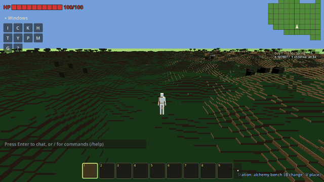
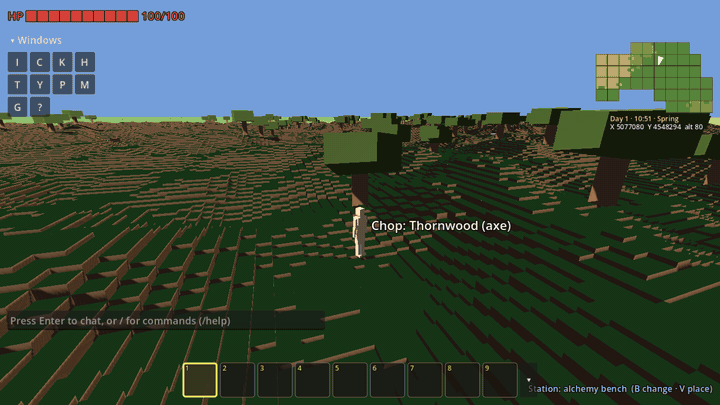
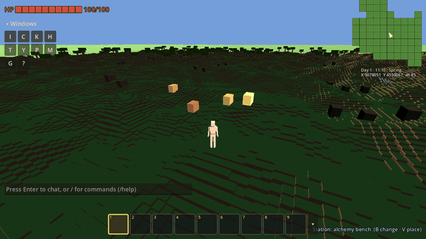

# Project Nihon

An open-source sandbox MMORPG where players build a civilization. The world is persistent, expands over time, and evolves entirely through player interaction — no scripted quests, no scripted economies, no pay-to-win.

The entire game design bible — materials, skills, creatures, items, world systems — is authored as a [Newel](https://github.com/Tubaleviao/newel) fabric and generated into documentation, runtime assets, and Godot resources.

---

## Gameplay

<p align="center">
  
  
  
</p>

<sub>Captured from the public build, which uses placeholder art.</sub>

---

## Quick start

```bash
npm ci            # or `npm install` to resolve the lockfile fresh
npm run validate  # validate the fabric against the schema
npm run inspect   # list all entities by name
npm run generate  # generate the design bible into bible/
```

Run the game with Godot 4.7 from the repository root. Running the tests, the two-client network harness, and the full fabric-first workflow are covered in [docs/DEVELOPMENT.md](docs/DEVELOPMENT.md).

### Testing

The unit suite (`-- --run-tests`), the two-client network harness (`tools/net_harness.sh`) and the playtest bot (`-- --playtest-bot`) are described in [docs/DEVELOPMENT.md](docs/DEVELOPMENT.md#testing). To see how the server holds up under a crowd, run the stress test locally:

```bash
STRESS_MAX=32 STRESS_PROFILES=lan GODOT=/path/to/Godot_v4.7-stable_linux.x86_64 tools/stress.sh
```

It boots a dedicated server, a watching client and a process of scripted bot players, walks them in five patterns at growing crowd sizes, and writes `stress/report.md` (the largest crowd that met every budget, and the ranked bottlenecks) and `stress/report.json`.

The crowd the host supports today (Phase 163, `lan`, one desktop machine): 64 players standing together (`cluster`) or crossing a pole (`pole`), 32 walking across AOI cells (`cross`), 16 spread out (`spread`) or joining and leaving every few seconds (`churn`). The starting point is [docs/perf/crowd-baseline.md](docs/perf/crowd-baseline.md); the `stress` CI job fails if any of these drops below the baseline.

---

## Status

170+ phases shipped so far: voxel terrain on a whole planet with continents, biomes, day/night and weather; mining, building and station-gated crafting; a technology tree and research; rigged, animated creatures with pack behavior, combat, taming and harvesting; settlements; host-authoritative multiplayer with persistence; waystone fast travel; and English and Brazilian Portuguese UI.

The current arc (Phases 173–181) makes it look and feel like an RPG: icons everywhere, character attributes, a character sheet and character creation. See [ROADMAP.md](ROADMAP.md) for the open phases and deferred work. Completed phases are archived in [docs/roadmap-history/](docs/roadmap-history/README.md) with their full spec and acceptance criteria.

Production art lives in a private `assets-prod/` git submodule (Git LFS); the public repo ships placeholders. See [assets/README.md](assets/README.md).

---

## Contributing

Major design decisions follow the community governance process described in the `CommunityOwnsTheFuture` principle — propose publicly, ratify by contributor consensus. See the constitution fabric for the full set of principles and current decisions, and [docs/DEVELOPMENT.md](docs/DEVELOPMENT.md) for branching, PR and testing conventions.
