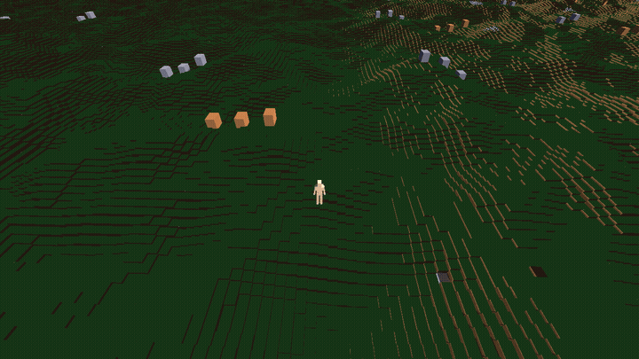
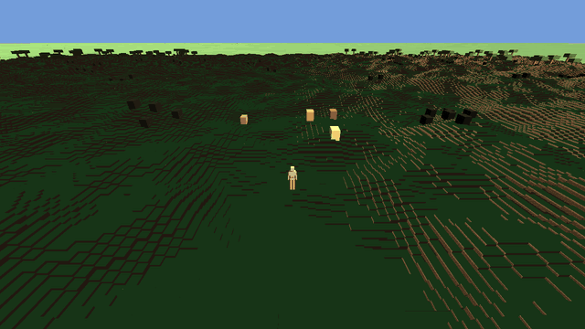

# Project Nihon

An open-source sandbox MMORPG where players build a civilization. The world is persistent, expands over time, and evolves entirely through player interaction — no scripted quests, no scripted economies, no pay-to-win.

The entire game design bible — materials, skills, creatures, items, world systems — is authored as a [Newel](https://github.com/Tubaleviao/newel) fabric and generated into documentation, runtime assets, and Godot resources.

---

## Gameplay

<p align="center">
  
  
</p>

<sub>Captured from the public build, which uses placeholder art. Creatures still show as boxes until
rigged models land (ROADMAP Phase 143).</sub>

---

## Quick start

```bash
npm ci            # or `npm install` to resolve the lockfile fresh
npm run validate  # validate the fabric against the schema
npm run inspect   # list all entities by name
npm run generate  # generate the design bible into bible/
```

Run the game with Godot 4.7 from the repository root. Running the tests, the two-client network harness, and the full fabric-first workflow are covered in [docs/DEVELOPMENT.md](docs/DEVELOPMENT.md).

---

## Status

140+ phases shipped so far: voxel terrain on a whole planet with continents, biomes, day/night and weather; mining, building and station-gated crafting; a technology tree and research; creatures with pack behavior, combat and taming; host-authoritative multiplayer with persistence; and waystone fast travel.

See [ROADMAP.md](ROADMAP.md) for the phase index, open phases and deferred work. Completed phases are archived in [docs/roadmap-history/](docs/roadmap-history/README.md) with their full spec and acceptance criteria.

Production art lives in a private `assets-prod/` git submodule (Git LFS); the public repo ships placeholders. See [assets/README.md](assets/README.md).

---

## Contributing

Major design decisions follow the community governance process described in the `CommunityOwnsTheFuture` principle — propose publicly, ratify by contributor consensus. See the constitution fabric for the full set of principles and current decisions, and [docs/DEVELOPMENT.md](docs/DEVELOPMENT.md) for branching, PR and testing conventions.
