<!-- @generated by @newel/generator-bible — do not edit -->
# Building

**Tags:** `skill`

Putting up and taking down structures: placing blocks, dismantling them cleanly and repairing worn ones. A higher level gets more back when dismantling (StructureDurability.dismantle) and grows from every block placed, dismantled or repaired.

> **Goal:** Reward builders and make careful dismantling a skill rather than a free refund

## Fields

| Name | Type | Required | Description |
| ---- | ---- | -------- | ----------- |
| `id` | uuid | yes |  |
| `tier` | enum (`novice`, `apprentice`, `journeyman`, `expert`, `master`) | yes |  |
| `xpCurve` | enum (`linear`, `quadratic`, `exponential`) | yes | XP required per tier |
| `maxLevel` | integer | yes | Maximum XP level within a tier before tier advance is required; the same as levelCap |
| `category` | enum (`combat`, `crafting`, `magic`, `exploration`, `social`, `survival`) | yes | Skill domain: crafting |
| `levelCap` | integer | yes | Highest Building level (WorkSkills.curves) |
| `xpToLevel` | json | yes | Cumulative XP needed to reach each level, index = level (WorkSkills.curves) |

### State machine

**Field:** `tier` &nbsp; **Initial:** `novice`

```mermaid
stateDiagram-v2
  [*] --> novice
  novice --> apprentice : advanceTier\n[XP threshold for the target tier must be met; XP comes only from the work WorkSkills maps to Building]
  apprentice --> journeyman : advanceTier\n[XP threshold for the target tier must be met; XP comes only from the work WorkSkills maps to Building]
  journeyman --> expert : advanceTier\n[XP threshold for the target tier must be met; XP comes only from the work WorkSkills maps to Building]
  expert --> master : advanceTier\n[XP threshold for the target tier must be met; XP comes only from the work WorkSkills maps to Building]
  master --> [*]
```

| State | Description | Terminal |
| ----- | ----------- | -------- |
| `novice` | Entry-level practitioner; basic techniques only |  |
| `apprentice` | Growing competence; intermediate techniques unlock |  |
| `journeyman` | Solid practitioner; advanced techniques and profession gates open |  |
| `expert` | Near-mastery; most advanced abilities available |  |
| `master` | Complete mastery; all abilities unlocked | yes |

| From | To | Trigger | Guards | Effects |
| ---- | --- | ------- | ------ | ------- |
| `novice` | `apprentice` | `advanceTier` | XP threshold for the target tier must be met; XP comes only from the work WorkSkills maps to Building |  |
| `apprentice` | `journeyman` | `advanceTier` | XP threshold for the target tier must be met; XP comes only from the work WorkSkills maps to Building |  |
| `journeyman` | `expert` | `advanceTier` | XP threshold for the target tier must be met; XP comes only from the work WorkSkills maps to Building |  |
| `expert` | `master` | `advanceTier` | XP threshold for the target tier must be met; XP comes only from the work WorkSkills maps to Building |  |

## Behaviors

### `advanceTier`

Progress to the next mastery tier through accumulated building XP

**Rules:**
- XP threshold for the target tier must be met
- XP comes only from the work WorkSkills maps to Building

**Auth:** `maintainer`

### `dismantle`

Take a structure apart for part of its materials

**Rules:**
- The share returned rises with Building level and falls with durability (StructureDurability.dismantle)

**Auth:** `maintainer`

