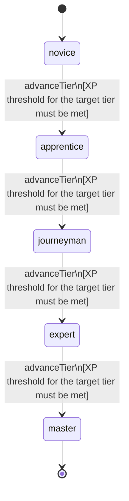

<!-- @generated by @newel/generator-bible — do not edit -->
# Foraging

**Tags:** `skill`

Gathering plants, herbs and fruit by hand. Every plant gathered grows it; each tier takes more from the same plant.

> **Goal:** Record that a player is a forager, apart from the alchemist who brews what is found

## Fields

| Name | Type | Required | Description |
| ---- | ---- | -------- | ----------- |
| `id` | uuid | yes |  |
| `tier` | enum (`novice`, `apprentice`, `journeyman`, `expert`, `master`) | yes |  |
| `xpCurve` | enum (`linear`, `quadratic`, `exponential`) | yes | XP required per tier |
| `maxLevel` | integer | yes | Maximum XP level within a tier before tier advance is required; the same as levelCap |
| `category` | enum (`combat`, `crafting`, `magic`, `exploration`, `social`, `gathering`) | yes | Skill domain: gathering |
| `levelCap` | integer | yes | Highest Foraging level (WorkSkills.curves) |
| `xpToLevel` | json | yes | Cumulative XP needed to reach each level, index = level (WorkSkills.curves) |
| `tierBonus` | json | yes | What each tier gives (WorkSkills.bonuses): a yield factor on plants gathered |

### State machine

**Field:** `tier` &nbsp; **Initial:** `novice`

| State | Description | Terminal |
| ----- | ----------- | -------- |
| `novice` | Entry-level practitioner; basic techniques only |  |
| `apprentice` | Growing competence; intermediate techniques unlock |  |
| `journeyman` | Solid practitioner; advanced techniques and profession gates open |  |
| `expert` | Near-mastery; most advanced abilities available |  |
| `master` | Complete mastery; all abilities unlocked | yes |

| From | To | Trigger | Guards | Effects |
| ---- | --- | ------- | ------ | ------- |
| `novice` | `apprentice` | `advanceTier` | XP threshold for the target tier must be met |  |
| `apprentice` | `journeyman` | `advanceTier` | XP threshold for the target tier must be met |  |
| `journeyman` | `expert` | `advanceTier` | XP threshold for the target tier must be met |  |
| `expert` | `master` | `advanceTier` | XP threshold for the target tier must be met |  |

## Behaviors

### `advanceTier`

Reach the next tier from accumulated Foraging XP (WorkSkills.tiers)

**Rules:**
- XP threshold for the target tier must be met

**Auth:** `maintainer`

### `forage`

Grow Foraging from the work its rows in WorkSkills.gather name

**Rules:**
- The host grants the XP per unit gathered from WorkSkills.gather, never from a client message
- Each tier applies its WorkSkills.bonuses.Foraging factor

**Auth:** `maintainer`

