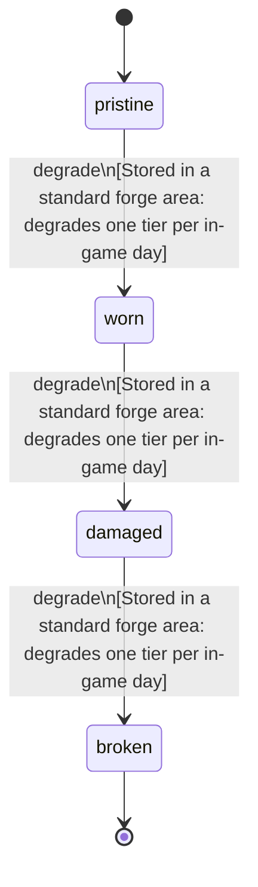

<!-- @generated by @newel/generator-bible — do not edit -->
# RefinedVoiditeShard

**Tags:** `item`

Raw voidite stabilised in a forge into a crystalline shard. The input of void rune etching and the repair material for voidite blades.

> **Goal:** Discrete refined form of voidite; the product of the risky refining recipe

## Fields

| Name | Type | Required | Description |
| ---- | ---- | -------- | ----------- |
| `id` | uuid | yes |  |
| `condition` | enum (`pristine`, `worn`, `damaged`, `broken`) | yes |  |
| `weight` | decimal | yes | kg per shard |
| `rarity` | enum (`common`, `uncommon`, `rare`, `epic`, `legendary`) | yes |  |
| `stackable` | boolean | yes | True; stacks up to 20 per slot |
| `shape` | json | yes | Item shape: archetype, material per named part, and uniform scale (Phase 151) |
| `durability` | integer | yes | Crystal integrity |

## Relations

| Name | Kind | Target | Foreign Key |
| ---- | ---- | ------ | ----------- |
| `voidite` | hasOne | [Voidite](voidite.md) |  |

### State machine

**Field:** `condition` &nbsp; **Initial:** `pristine`

| State | Description | Terminal |
| ----- | ----------- | -------- |
| `pristine` | Full potency or freshness; ready for use |  |
| `worn` | Reduced potency; still usable |  |
| `damaged` | Significantly degraded; use with caution |  |
| `broken` | Spoiled or fully depleted; cannot be used or repaired | yes |

| From | To | Trigger | Guards | Effects |
| ---- | --- | ------- | ------ | ------- |
| `pristine` | `worn` | `degrade` | Stored in a standard forge area: degrades one tier per in-game day |  |
| `worn` | `damaged` | `degrade` | Stored in a standard forge area: degrades one tier per in-game day |  |
| `damaged` | `broken` | `degrade` | Stored in a standard forge area: degrades one tier per in-game day |  |

## Behaviors

### `degrade`

Shard integrity degrades outside void-lined storage

**Rules:**
- Stored in a standard forge area: degrades one tier per in-game day

**Auth:** `maintainer`

