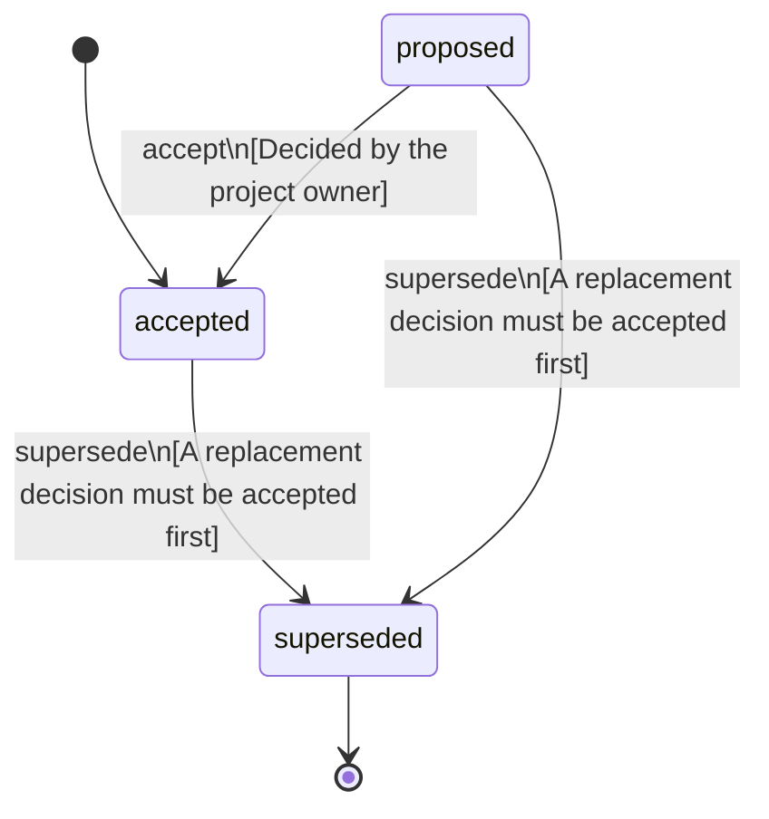

<!-- @generated by @newel/generator-bible — do not edit -->
# ResearchSharedByWriting

**Tags:** `decision`

Research is per player and is shared only by writing: a Book teaches one researched technology and a Blueprint one structure or station recipe. Only a player who knows the content can write one, at a material cost, and reading never consumes it, so it can be read again and lent. Research never draws from a shared stockpile.

> **Goal:** Keep knowledge a personal achievement that players trade and teach (KnowledgeIsProgression, Phase 203)

## Fields

| Name | Type | Required | Description |
| ---- | ---- | -------- | ----------- |
| `id` | uuid | yes |  |
| `status` | enum (`proposed`, `accepted`, `superseded`) | yes |  |
| `decided` | string | yes | The day the owner decided it |

## Relations

| Name | Kind | Target | Foreign Key |
| ---- | ---- | ------ | ----------- |
| `book` | hasOne | [Book](book.md) |  |
| `blueprint` | hasOne | [Blueprint](blueprint.md) |  |

### State machine

**Field:** `status` &nbsp; **Initial:** `accepted`

| State | Description | Terminal |
| ----- | ----------- | -------- |
| `proposed` | Decision is under community discussion |  |
| `accepted` | Decision is ratified and in effect |  |
| `superseded` | Decision has been replaced by a newer decision | yes |

| From | To | Trigger | Guards | Effects |
| ---- | --- | ------- | ------ | ------- |
| `proposed` | `accepted` | `accept` | Decided by the project owner |  |
| `proposed`, `accepted` | `superseded` | `supersede` | A replacement decision must be accepted first |  |

## Behaviors

### `accept`

Ratify this decision

**Rules:**
- Decided by the project owner

**Auth:** `maintainer`

### `supersede`

Mark this decision as replaced by a newer one

**Rules:**
- A replacement decision must be accepted first

**Auth:** `maintainer`

