<!-- @generated by @newel/generator-bible — do not edit -->
# SettlementRaidsAndUpkeep

**Tags:** `decision`

Raids on a settlement are fair: every raid is warned (SettlementRaids.warningSeconds > 0), none starts unless a member is online inside the claim (offlineProtection), and a lost raid takes at most a capped share of the stockpile and of unfinished project labour, never the claim or finished structures. Raids come from creatures only. Upkeep is a per-tier cost from the stockpile that never falls as the tier rises; unpaid upkeep suspends project effects and never shrinks the claim, which follows only the activity-based abandonment rule (SettlementClaimAndDecay).

> **Goal:** Give a village something to defend and to keep paying for without punishing players for logging off (TheWorldIsPersistent, EverythingHasTradeoffs, Phase 197)

## Fields

| Name | Type | Required | Description |
| ---- | ---- | -------- | ----------- |
| `id` | uuid | yes |  |
| `status` | enum (`proposed`, `accepted`, `superseded`) | yes |  |

## Relations

| Name | Kind | Target | Foreign Key |
| ---- | ---- | ------ | ----------- |
| `raids` | hasOne | [SettlementRaids](settlementraids.md) |  |
| `upkeep` | hasOne | [SettlementUpkeep](settlementupkeep.md) |  |

### State machine

**Field:** `status` &nbsp; **Initial:** `proposed`

```mermaid
stateDiagram-v2
  [*] --> proposed
  proposed --> accepted : accept\n[Community vote must reach quorum; Warning, offline protection, loss caps and upkeep costs live in the SettlementRaids and SettlementUpkeep rules]
  proposed --> superseded : supersede\n[A replacement decision must be accepted first]
  accepted --> superseded : supersede\n[A replacement decision must be accepted first]
  superseded --> [*]
```

| State | Description | Terminal |
| ----- | ----------- | -------- |
| `proposed` | Decision is under community discussion |  |
| `accepted` | Decision is ratified and in effect |  |
| `superseded` | Decision has been replaced by a newer decision | yes |

| From | To | Trigger | Guards | Effects |
| ---- | --- | ------- | ------ | ------- |
| `proposed` | `accepted` | `accept` | Community vote must reach quorum; Warning, offline protection, loss caps and upkeep costs live in the SettlementRaids and SettlementUpkeep rules |  |
| `proposed`, `accepted` | `superseded` | `supersede` | A replacement decision must be accepted first |  |

## Behaviors

### `accept`

Ratify the raid fairness and upkeep rules after community review

**Rules:**
- Community vote must reach quorum
- Warning, offline protection, loss caps and upkeep costs live in the SettlementRaids and SettlementUpkeep rules

**Auth:** `maintainer`

### `supersede`

Mark this decision as replaced by a newer one

**Rules:**
- A replacement decision must be accepted first

**Auth:** `maintainer`

