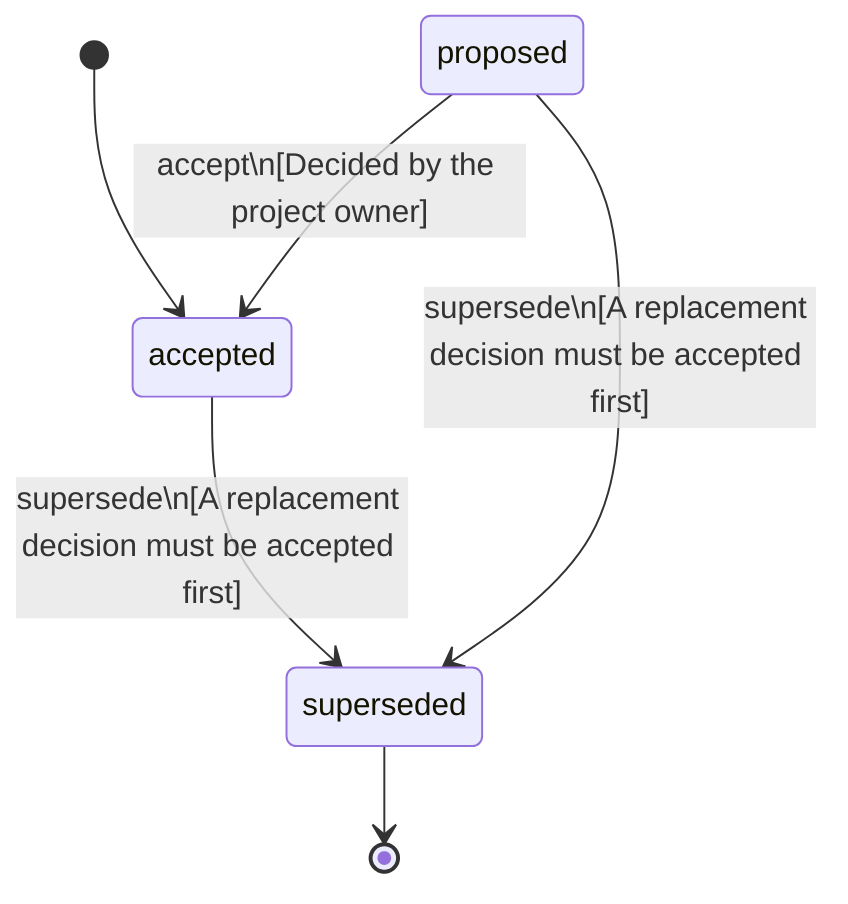

<!-- @generated by @newel/generator-bible — do not edit -->
# SkillsGrowFromWork

**Tags:** `decision`

Crafting, gathering, building, dismantling and repairing grow the worker's own skill for that kind of work (sewing makes you a better sewer). Nothing a member does is progress for a clan: clan projects have no labour and are complete once their materials are in. Clan tiers come from the buildings a clan owns and their material rarity, and give nothing yet. Raids are not wanted now (deferred) and upkeep is removed. Clan skills for top contributors and elder-only buildings come later.

> **Goal:** Make a specialty the result of how someone plays, and a clan the sum of its members (EverythingHasTradeoffs, Phase 203)

## Fields

| Name | Type | Required | Description |
| ---- | ---- | -------- | ----------- |
| `id` | uuid | yes |  |
| `status` | enum (`proposed`, `accepted`, `superseded`) | yes |  |
| `decided` | string | yes | The day the owner decided it |

## Relations

| Name | Kind | Target | Foreign Key |
| ---- | ---- | ------ | ----------- |
| `work` | hasOne | [WorkSkills](workskills.md) |  |
| `tiers` | hasOne | [ClanTiers](clantiers.md) |  |
| `replaces` | hasOne | [SettlementRaidsAndUpkeep](settlementraidsandupkeep.md) |  |

### State machine

**Field:** `status` &nbsp; **Initial:** `accepted`

| State | Description | Terminal |
| ----- | ----------- | -------- |
| `proposed` | Decision is under community discussion |  |
| `accepted` | Decision is ratified and in effect |  |
| `superseded` | Decision has been replaced by a newer decision | yes |

| From | To | Trigger | Guards | Effects |
| ---- | --- | ------- | ------ | ------- |
| `proposed` | `accepted` | `accept` | Decided by the project owner |  |
| `proposed`, `accepted` | `superseded` | `supersede` | A replacement decision must be accepted first |  |

## Behaviors

### `accept`

Ratify this decision

**Rules:**
- Decided by the project owner

**Auth:** `maintainer`

### `supersede`

Mark this decision as replaced by a newer one

**Rules:**
- A replacement decision must be accepted first

**Auth:** `maintainer`

