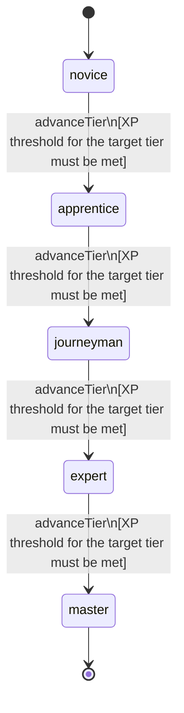

<!-- @generated by @newel/generator-bible — do not edit -->
# Skinning

**Tags:** `skill`

Working a creature body with a knife or bone tool. A higher level takes more from the same body (quantity runs from the table's minimum at level 0 to its maximum at the cap), more reliably, and of better quality. It also lets a harvester carry heavier bodies.

> **Goal:** Make a kill a body to work rather than a pile of finished drops, and reward practice with the knife

## Fields

| Name | Type | Required | Description |
| ---- | ---- | -------- | ----------- |
| `id` | uuid | yes |  |
| `tier` | enum (`novice`, `apprentice`, `journeyman`, `expert`, `master`) | yes |  |
| `xpCurve` | enum (`linear`, `quadratic`, `exponential`) | yes | XP required per tier |
| `maxLevel` | integer | yes | Maximum XP level within a tier before tier advance is required |
| `category` | enum (`combat`, `crafting`, `magic`, `exploration`, `social`, `survival`) | yes | Skill domain: survival |
| `levelCap` | integer | yes | Highest Skinning level; the tables below have one entry per level 0..levelCap |
| `xpPerHarvest` | integer | yes | Skinning XP a finished harvest grants |
| `xpToLevel` | json | yes | Cumulative XP needed to reach each level, index = level |
| `yieldCurve` | json | yes | Fraction 0..1 of the minQty..maxQty range a harvest reaches, index = effective level |
| `chanceCurve` | json | yes | Chance added to each entry (total capped at 1.0), index = effective level |
| `qualityCurve` | json | yes | Quality grade (poor, common, fine, prime) of raw creature materials, index = effective level |

### State machine

**Field:** `tier` &nbsp; **Initial:** `novice`

| State | Description | Terminal |
| ----- | ----------- | -------- |
| `novice` | Entry-level practitioner; basic techniques only |  |
| `apprentice` | Growing competence; intermediate techniques unlock |  |
| `journeyman` | Solid practitioner; advanced techniques and profession gates open |  |
| `expert` | Near-mastery; most advanced abilities available |  |
| `master` | Complete mastery; all abilities unlocked | yes |

| From | To | Trigger | Guards | Effects |
| ---- | --- | ------- | ------ | ------- |
| `novice` | `apprentice` | `advanceTier` | XP threshold for the target tier must be met |  |
| `apprentice` | `journeyman` | `advanceTier` | XP threshold for the target tier must be met |  |
| `journeyman` | `expert` | `advanceTier` | XP threshold for the target tier must be met |  |
| `expert` | `master` | `advanceTier` | XP threshold for the target tier must be met |  |

## Behaviors

### `advanceTier`

Progress to the next mastery tier through accumulated skinning XP

**Rules:**
- XP threshold for the target tier must be met

**Auth:** `maintainer`

### `harvest`

Work a creature body with the right tool

**Rules:**
- Effective level is floor(level * tool efficiency); it indexes yieldCurve, chanceCurve and qualityCurve
- Quality is a property of the item instance, not a separate item id
- A finished harvest grants xpPerHarvest

**Auth:** `maintainer`

