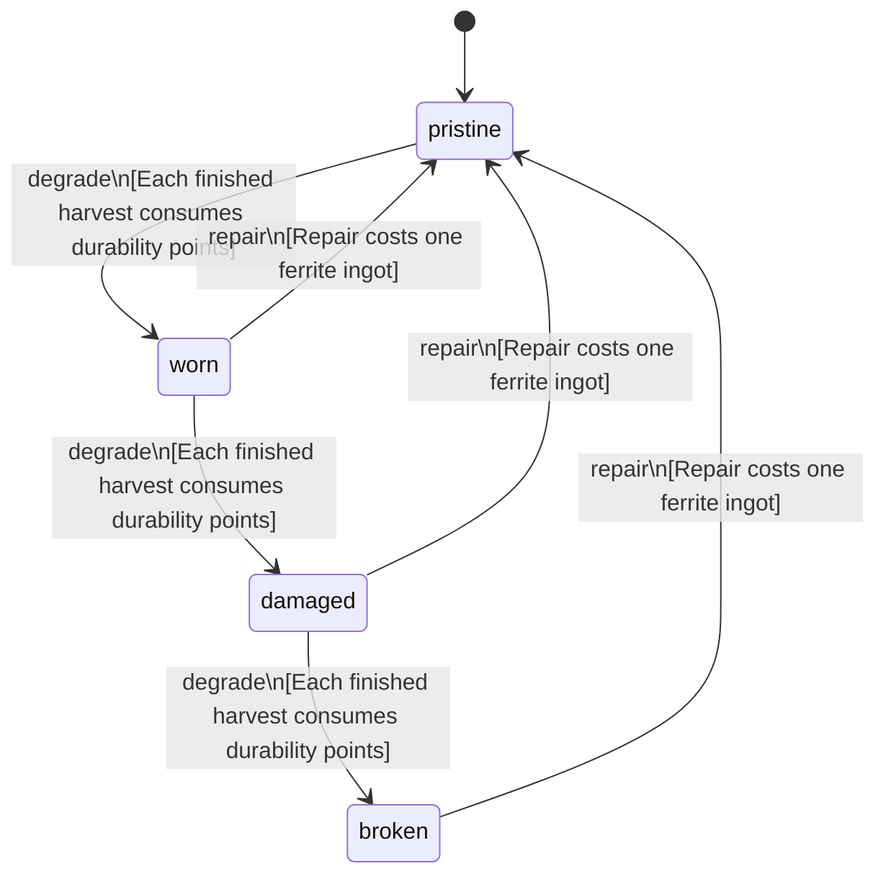

<!-- @generated by @newel/generator-bible — do not edit -->
# SkinningKnife

**Tags:** `item`

Short ferrite blade on a thornwood grip, ground for pelts and meat. Takes hide, pelt and organs from a body; the knife category of the harvest tables.

> **Goal:** Entry harvest tool; gates the knife entries of every creature body

## Fields

| Name | Type | Required | Description |
| ---- | ---- | -------- | ----------- |
| `id` | uuid | yes |  |
| `condition` | enum (`pristine`, `worn`, `damaged`, `broken`) | yes |  |
| `weight` | decimal | yes | kg; affects carry capacity |
| `rarity` | enum (`common`, `uncommon`, `rare`, `epic`, `legendary`) | yes |  |
| `stackable` | boolean | yes | Whether multiple instances stack in inventory |
| `shape` | json | yes | Item shape: archetype, material per named part, and uniform scale (Phase 151) |
| `durability` | integer | yes | Remaining durability points before condition degrades |
| `toolType` | string | yes | Tool class — the action this tool performs. "pick" mines, "axe" chops. |
| `harvestTool` | string | yes | Harvest tool category this item provides (Phase 160): knife or bonetool |
| `efficiency` | decimal | yes | How well it works that category, in (0, 1]; below 1.0 is a poor substitute |
| `repair` | json | yes | Structured repair spec: required station, materials consumed on repair, and skill guards (skill key + minimum tier). |

## Relations

| Name | Kind | Target | Foreign Key |
| ---- | ---- | ------ | ----------- |
| `ferrite` | hasOne | [Ferrite](ferrite.md) |  |
| `thornwood` | hasOne | [Thornwood](thornwood.md) |  |

### State machine

**Field:** `condition` &nbsp; **Initial:** `pristine`

| State | Description | Terminal |
| ----- | ----------- | -------- |
| `pristine` | Freshly crafted or repaired; full stat effectiveness |  |
| `worn` | Showing use; minor stat penalties apply |  |
| `damaged` | Significantly degraded; notable stat penalties; repair strongly advised |  |
| `broken` | Unusable; must be repaired at a workshop before use |  |

| From | To | Trigger | Guards | Effects |
| ---- | --- | ------- | ------ | ------- |
| `pristine` | `worn` | `degrade` | Each finished harvest consumes durability points |  |
| `worn` | `damaged` | `degrade` | Each finished harvest consumes durability points |  |
| `damaged` | `broken` | `degrade` | Each finished harvest consumes durability points |  |
| `broken` | `pristine` | `repair` | Repair costs one ferrite ingot |  |
| `damaged` | `pristine` | `repair` | Repair costs one ferrite ingot |  |
| `worn` | `pristine` | `repair` | Repair costs one ferrite ingot |  |

## Behaviors

### `degrade`

Reduce durability after each harvest

**Rules:**
- Each finished harvest consumes durability points

**Auth:** `maintainer`

### `repair`

Restore to pristine condition at a forge

**Rules:**
- Repair costs one ferrite ingot

**Auth:** `maintainer`

