<!-- @generated by @newel/generator-bible — do not edit -->
# StoneHammer

**Tags:** `item`

A heavy round stone bound to a short branch. Held to build walls, floors and roofs; benches need none.

> **Goal:** The building tool: a shelter needs a hammer in hand, a bench does not (Phase 260)

## Fields

| Name | Type | Required | Description |
| ---- | ---- | -------- | ----------- |
| `id` | uuid | yes |  |
| `condition` | enum (`pristine`, `worn`, `damaged`, `broken`) | yes |  |
| `weight` | decimal | yes | kg; affects carry capacity |
| `rarity` | enum (`common`, `uncommon`, `rare`, `epic`, `legendary`) | yes |  |
| `stackable` | boolean | yes | Whether multiple instances stack in inventory |
| `shape` | json | yes | Item shape: archetype, material per named part, and uniform scale (Phase 151) |
| `durability` | integer | yes | Remaining durability points before condition degrades |
| `equipmentCategory` | string | yes | Equipment category (Phase 295): knife, sword, axe, hammer, pick, shovel… |
| `traits` | json | yes | Traits and strengths (Phase 295): { <Trait>: { strength, grade? } }; the working part's material may raise them |
| `repair` | json | yes | Structured repair spec: required station, materials consumed on repair, and skill guards (skill key + minimum tier). |
| `works` | json | yes | Derived from the work table (Phase 295): { <work>: speed } for every work this item can do |
| `combatDamage` | json | yes | Derived (Phase 295): combat damage per damage type, the category multiplier times its traits' shares |

## Relations

| Name | Kind | Target | Foreign Key |
| ---- | ---- | ------ | ----------- |
| `ashite` | hasOne | [Ashite](ashite.md) |  |
| `thornwood` | hasOne | [Thornwood](thornwood.md) |  |

### State machine

**Field:** `condition` &nbsp; **Initial:** `pristine`

```mermaid
stateDiagram-v2
  [*] --> pristine
  pristine --> worn : degrade\n[Each use consumes one durability point]
  worn --> damaged : degrade\n[Each use consumes one durability point]
  damaged --> broken : degrade\n[Each use consumes one durability point]
  broken --> pristine : repair\n[Needs no station; Repair costs one loose stone per condition tier restored]
  damaged --> pristine : repair\n[Needs no station; Repair costs one loose stone per condition tier restored]
  worn --> pristine : repair\n[Needs no station; Repair costs one loose stone per condition tier restored]
```

| State | Description | Terminal |
| ----- | ----------- | -------- |
| `pristine` | Freshly crafted or repaired; full stat effectiveness |  |
| `worn` | Showing use; minor stat penalties apply |  |
| `damaged` | Significantly degraded; notable stat penalties; repair strongly advised |  |
| `broken` | Unusable; must be repaired at a workshop before use |  |

| From | To | Trigger | Guards | Effects |
| ---- | --- | ------- | ------ | ------- |
| `pristine` | `worn` | `degrade` | Each use consumes one durability point |  |
| `worn` | `damaged` | `degrade` | Each use consumes one durability point |  |
| `damaged` | `broken` | `degrade` | Each use consumes one durability point |  |
| `broken` | `pristine` | `repair` | Needs no station; Repair costs one loose stone per condition tier restored |  |
| `damaged` | `pristine` | `repair` | Needs no station; Repair costs one loose stone per condition tier restored |  |
| `worn` | `pristine` | `repair` | Needs no station; Repair costs one loose stone per condition tier restored |  |

## Behaviors

### `degrade`

Reduce durability with each use; a stone head chips quickly

**Rules:**
- Each use consumes one durability point

**Auth:** `maintainer`

### `repair`

Knap a fresh edge onto the head with a loose stone, anywhere

**Rules:**
- Needs no station
- Repair costs one loose stone per condition tier restored

**Auth:** `maintainer`

