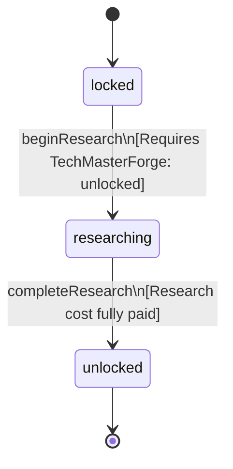

<!-- @generated by @newel/generator-bible — do not edit -->
# TechConcrete

**Tags:** `technology`

Grinding ashite to cement and casting it with soil. Unlocks concrete, which carries ten floors.

> **Goal:** The first material past stone (Phase 212)

## Fields

| Name | Type | Required | Description |
| ---- | ---- | -------- | ----------- |
| `id` | uuid | yes |  |
| `status` | enum (`locked`, `researching`, `unlocked`) | yes |  |
| `researchCost` | integer | yes | Research points spent to begin research (Phase 124); earned by the ResearchPointRule table |
| `tier` | integer | yes | Technology tree tier |
| `tech` | json | yes | Structured technology data: recipe unlocks, prerequisite technologies, research duration (seconds), and material cost consumed to begin research. |

## Relations

| Name | Kind | Target | Foreign Key |
| ---- | ---- | ------ | ----------- |
| `requiresTechMasterForge` | hasOne | [TechMasterForge](techmasterforge.md) |  |
| `unlocksRecipeCement` | hasOne | [RecipeCement](recipecement.md) |  |
| `unlocksRecipeConcrete` | hasOne | [RecipeConcrete](recipeconcrete.md) |  |

### State machine

**Field:** `status` &nbsp; **Initial:** `locked`

| State | Description | Terminal |
| ----- | ----------- | -------- |
| `locked` | Prerequisites not yet met; technology is not visible in the research interface |  |
| `researching` | Player or guild has committed resources; research progresses over time |  |
| `unlocked` | Research complete; all associated recipes and abilities are available | yes |

| From | To | Trigger | Guards | Effects |
| ---- | --- | ------- | ------ | ------- |
| `locked` | `researching` | `beginResearch` | Requires TechMasterForge: unlocked |  |
| `researching` | `unlocked` | `completeResearch` | Research cost fully paid |  |

## Behaviors

### `beginResearch`

Commit resources to concrete research

**Rules:**
- Requires TechMasterForge: unlocked

**Auth:** `maintainer`

### `completeResearch`

Finish research; its recipes become craftable

**Rules:**
- Research cost fully paid

**Auth:** `maintainer`

