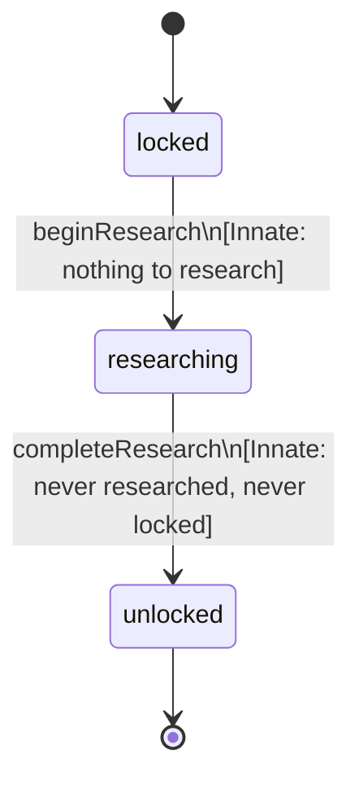

<!-- @generated by @newel/generator-bible — do not edit -->
# TechStoneTools

**Tags:** `technology`

Lashing a stone to a branch. Every person knows it from the start: the stone axe, pick, shovel and knife need no station and no research.

> **Goal:** Root of everything: the first tools a newcomer makes with bare hands (Phase 260)

## Fields

| Name | Type | Required | Description |
| ---- | ---- | -------- | ----------- |
| `id` | uuid | yes |  |
| `status` | enum (`locked`, `researching`, `unlocked`) | yes |  |
| `researchCost` | integer | yes | Research points spent to begin research (Phase 124); earned by the ResearchPointRule table |
| `tier` | integer | yes | Technology tree tier (1 = root) |
| `tech` | json | yes | Structured technology data: recipe unlocks, prerequisite technologies, research duration (seconds), and material cost consumed to begin research. |

## Relations

| Name | Kind | Target | Foreign Key |
| ---- | ---- | ------ | ----------- |
| `unlocksRecipeStoneAxe` | hasOne | [RecipeStoneAxe](recipestoneaxe.md) |  |
| `unlocksRecipeStonePick` | hasOne | [RecipeStonePick](recipestonepick.md) |  |
| `unlocksRecipeStoneShovel` | hasOne | [RecipeStoneShovel](recipestoneshovel.md) |  |
| `unlocksRecipeStoneKnife` | hasOne | [RecipeStoneKnife](recipestoneknife.md) |  |

### State machine

**Field:** `status` &nbsp; **Initial:** `locked`

| State | Description | Terminal |
| ----- | ----------- | -------- |
| `locked` | Prerequisites not yet met; technology is not visible in the research interface |  |
| `researching` | Player or guild has committed resources; research progresses over time |  |
| `unlocked` | Research complete; all associated recipes and abilities are available | yes |

| From | To | Trigger | Guards | Effects |
| ---- | --- | ------- | ------ | ------- |
| `locked` | `researching` | `beginResearch` | Innate: nothing to research |  |
| `researching` | `unlocked` | `completeResearch` | Innate: never researched, never locked |  |

## Behaviors

### `beginResearch`

Never begun: an innate technology is unlocked from the start

**Rules:**
- Innate: nothing to research

**Auth:** `maintainer`

### `completeResearch`

Known from birth: every character starts with it unlocked

**Rules:**
- Innate: never researched, never locked

**Auth:** `maintainer`

