<!-- @generated by @newel/generator-bible — do not edit -->
# WaystonesAmendNoTeleportation

**Tags:** `decision`

Amends NoTeleportation: waystones are the one sanctioned fast travel. A player must build and stock a waystone network, travel only between stones they are attuned to, and pay an item cost scaled by distance, so travel remains infrastructure and a cost, never free or arbitrary teleportation. Placement policy for stations: a station whose fabric rule names a placement item (the waystone and the settlement hearth) consumes one from the placer on the host, so the network is built from crafted stones and cannot be spawned for free; workshop stations (forge, benches) are gated by skill and technology rather than an item and stay free to place.

> **Goal:** Keep a planet that takes about 90 days to walk around navigable without making geography meaningless

## Fields

| Name | Type | Required | Description |
| ---- | ---- | -------- | ----------- |
| `id` | uuid | yes |  |
| `status` | enum (`proposed`, `accepted`, `superseded`) | yes |  |

### State machine

**Field:** `status` &nbsp; **Initial:** `proposed`

```mermaid
stateDiagram-v2
  [*] --> proposed
  proposed --> accepted : accept\n[Community vote must reach quorum; Stones consume the Waystone item to place and an item cost to travel (WaystoneTravel)]
  proposed --> superseded : supersede\n[A replacement decision must be accepted first]
  accepted --> superseded : supersede\n[A replacement decision must be accepted first]
  superseded --> [*]
```

| State | Description | Terminal |
| ----- | ----------- | -------- |
| `proposed` | Decision is under community discussion |  |
| `accepted` | Decision is ratified and in effect |  |
| `superseded` | Decision has been replaced by a newer decision | yes |

| From | To | Trigger | Guards | Effects |
| ---- | --- | ------- | ------ | ------- |
| `proposed` | `accepted` | `accept` | Community vote must reach quorum; Stones consume the Waystone item to place and an item cost to travel (WaystoneTravel) |  |
| `proposed`, `accepted` | `superseded` | `supersede` | A replacement decision must be accepted first |  |

## Behaviors

### `accept`

Ratify this amendment after community review

**Rules:**
- Community vote must reach quorum
- Stones consume the Waystone item to place and an item cost to travel (WaystoneTravel)

**Auth:** `maintainer`

### `supersede`

Mark this decision as replaced by a newer one

**Rules:**
- A replacement decision must be accepted first

**Auth:** `maintainer`

