<!-- @generated by @newel/generator-wiki — do not edit -->
---
title: "AlchemyBench"
---

# AlchemyBench

`item` · `station`

A plank table set with aethermite-lined bowls for brewing. Placed from the hotbar as a alchemy bench station; its owner can pick it up again.

> The alchemy station, built at a carpentry bench (Phase 268)

## Attributes

| Field | Type | Description |
| ----- | ---- | ----------- |
| condition | `pristine`, `worn`, `damaged`, `broken` |  |
| weight | decimal | kg per alchemy bench |
| rarity | `common`, `uncommon`, `rare`, `epic`, `legendary` |  |
| stackable | boolean | False; one alchemy bench per slot |
| shape | json | Item shape: archetype, material per named part, and uniform scale (Phase 151) |
| durability | integer | Structural integrity |

## Related

| Name | Kind | Target |
| ---- | ---- | ------ |
| thornwood | hasOne | [Thornwood](thornwood.md) |
| aethermite | hasOne | [Aethermite](aethermite.md) |

## States

```mermaid
stateDiagram-v2
  [*] --> pristine
  pristine --> worn : degrade [Normal inventory storage never degrades a alchemy bench]
  worn --> damaged : degrade [Normal inventory storage never degrades a alchemy bench]
  damaged --> broken : degrade [Normal inventory storage never degrades a alchemy bench]
  broken --> pristine : repair [Requires a carpentry bench; no additional materials consumed]
  damaged --> pristine : repair [Requires a carpentry bench; no additional materials consumed]
  worn --> pristine : repair [Requires a carpentry bench; no additional materials consumed]
```

| State | Description |
| ----- | ----------- |
| `pristine` | Freshly crafted or repaired; full stat effectiveness |
| `worn` | Showing use; minor stat penalties apply |
| `damaged` | Significantly degraded; notable stat penalties; repair strongly advised |
| `broken` | Unusable; must be repaired at a workshop before use |

## Actions

### degrade

A alchemy bench does not wear while carried

**Conditions:**
- Normal inventory storage never degrades a alchemy bench

### repair

Re-join a worn alchemy bench at a carpentry bench

**Conditions:**
- Requires a carpentry bench; no additional materials consumed

