<!-- @generated by @newel/generator-wiki — do not edit -->
---
title: "BookTechBasicSmithing"
---

# BookTechBasicSmithing

`item` · `writing`

A book that teaches the technology TechBasicSmithing. Reading it teaches it and keeps it, so it can be read again or lent.

> Research shared by writing, never through a clan (ResearchSharedByWriting, Phase 209)

## Attributes

| Field | Type | Description |
| ----- | ---- | ----------- |
| condition | `pristine`, `worn`, `damaged`, `broken` |  |
| weight | decimal | kg per book |
| rarity | `common`, `uncommon`, `rare`, `epic`, `legendary` |  |
| stackable | boolean | True; copies of one writing stack |
| writing | string | The writing rule it follows (GameData.WRITINGS) |
| teaches | string | The technology, recipe or project key it teaches |
| teachesKind | string | technology, station or project |
| shape | json | Item shape: archetype, material per named part, and uniform scale (Phase 151) |
| durability | integer | Binding integrity |

## Related

| Name | Kind | Target |
| ---- | ---- | ------ |
| duskfiber | hasOne | [Duskfiber](duskfiber.md) |
| ferrite | hasOne | [Ferrite](ferrite.md) |

## States

```mermaid
stateDiagram-v2
  [*] --> pristine
  pristine --> worn : degrade [Reading never consumes or wears it]
  worn --> damaged : degrade [Reading never consumes or wears it]
  damaged --> broken : degrade [Reading never consumes or wears it]
  broken --> pristine : repair [Requires a carpentry bench; no additional materials consumed]
  damaged --> pristine : repair [Requires a carpentry bench; no additional materials consumed]
  worn --> pristine : repair [Requires a carpentry bench; no additional materials consumed]
```

| State | Description |
| ----- | ----------- |
| `pristine` | Freshly crafted or repaired; full stat effectiveness |
| `worn` | Showing use; minor stat penalties apply |
| `damaged` | Significantly degraded; notable stat penalties; repair strongly advised |
| `broken` | Unusable; must be repaired at a workshop before use |

## Actions

### degrade

A book does not wear while carried or read

**Conditions:**
- Reading never consumes or wears it

### repair

Re-bind a worn book at a carpentry bench

**Conditions:**
- Requires a carpentry bench; no additional materials consumed

