<!-- @generated by @newel/generator-wiki — do not edit -->
---
title: "Building"
---

# Building

`skill`

Putting up and taking down structures: placing blocks, dismantling them cleanly and repairing worn ones. A higher level gets more back when dismantling (StructureDurability.dismantle) and grows from every block placed, dismantled or repaired.

> Reward builders and make careful dismantling a skill rather than a free refund

## Attributes

| Field | Type | Description |
| ----- | ---- | ----------- |
| tier | `novice`, `apprentice`, `journeyman`, `expert`, `master` |  |
| xpCurve | `linear`, `quadratic`, `exponential` | XP required per tier |
| maxLevel | integer | Maximum XP level within a tier before tier advance is required; the same as levelCap |
| category | `combat`, `crafting`, `magic`, `exploration`, `social`, `survival` | Skill domain: crafting |
| levelCap | integer | Highest Building level (WorkSkills.curves) |
| xpToLevel | json | Cumulative XP needed to reach each level, index = level (WorkSkills.curves) |

## States

```mermaid
stateDiagram-v2
  [*] --> novice
  novice --> apprentice : advanceTier [XP threshold for the target tier must be met; XP comes only from the work WorkSkills maps to Building]
  apprentice --> journeyman : advanceTier [XP threshold for the target tier must be met; XP comes only from the work WorkSkills maps to Building]
  journeyman --> expert : advanceTier [XP threshold for the target tier must be met; XP comes only from the work WorkSkills maps to Building]
  expert --> master : advanceTier [XP threshold for the target tier must be met; XP comes only from the work WorkSkills maps to Building]
  master --> [*]
```

| State | Description |
| ----- | ----------- |
| `novice` | Entry-level practitioner; basic techniques only |
| `apprentice` | Growing competence; intermediate techniques unlock |
| `journeyman` | Solid practitioner; advanced techniques and profession gates open |
| `expert` | Near-mastery; most advanced abilities available |
| `master` | Complete mastery; all abilities unlocked |

## Actions

### advanceTier

Progress to the next mastery tier through accumulated building XP

**Conditions:**
- XP threshold for the target tier must be met
- XP comes only from the work WorkSkills maps to Building

### dismantle

Take a structure apart for part of its materials

**Conditions:**
- The share returned rises with Building level and falls with durability (StructureDurability.dismantle)

