<!-- @generated by @newel/generator-wiki — do not edit -->
---
title: "Cement"
---

# Cement

`item`

Ashite ground to a fine grey powder at a masonry bench. Mixed with soil and cast, it sets into concrete.

> The intermediate of concrete: ties volcanic ashite to the first material past stone (Phase 212)

## Attributes

| Field | Type | Description |
| ----- | ---- | ----------- |
| condition | `pristine`, `worn`, `damaged`, `broken` |  |
| weight | decimal | kg per sack |
| rarity | `common`, `uncommon`, `rare`, `epic`, `legendary` |  |
| stackable | boolean | True; stacks up to 40 per slot |
| shape | json | Item shape: archetype, material per named part, and uniform scale (Phase 151) |
| durability | integer | Structural integrity |

## Related

| Name | Kind | Target |
| ---- | ---- | ------ |
| ashite | hasOne | [Ashite](ashite.md) |

## States

```mermaid
stateDiagram-v2
  [*] --> pristine
  pristine --> worn : degrade [Cement kept in a pack or a chest never degrades]
  worn --> damaged : degrade [Cement kept in a pack or a chest never degrades]
  damaged --> broken : degrade [Cement kept in a pack or a chest never degrades]
  broken --> pristine : repair [Requires a masonry bench; no additional materials consumed]
  damaged --> pristine : repair [Requires a masonry bench; no additional materials consumed]
  worn --> pristine : repair [Requires a masonry bench; no additional materials consumed]
```

| State | Description |
| ----- | ----------- |
| `pristine` | Freshly crafted or repaired; full stat effectiveness |
| `worn` | Showing use; minor stat penalties apply |
| `damaged` | Significantly degraded; notable stat penalties; repair strongly advised |
| `broken` | Unusable; must be repaired at a workshop before use |

## Actions

### degrade

Cement left in the rain sets into a useless lump

**Conditions:**
- Cement kept in a pack or a chest never degrades

### repair

Regrind a set lump back to cement at a masonry bench

**Conditions:**
- Requires a masonry bench; no additional materials consumed

