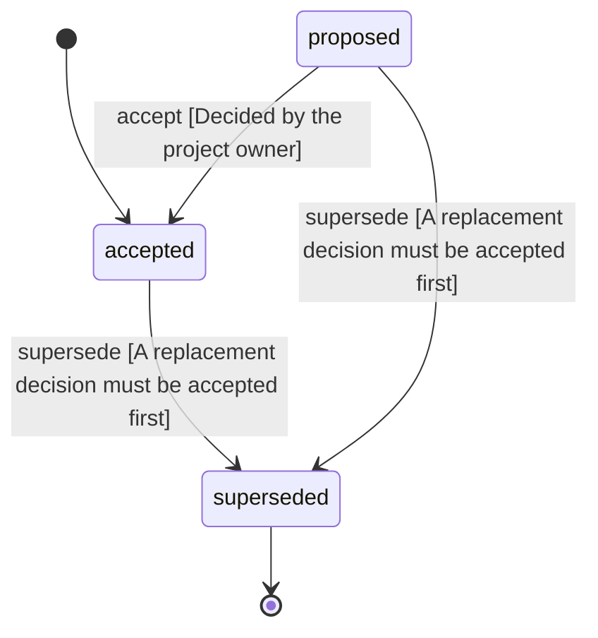

<!-- @generated by @newel/generator-wiki — do not edit -->
---
title: "ClansAndOwnedStructures"
---

# ClansAndOwnedStructures

`decision`

A player founds a clan by choosing its name and invites other players; a clan has any number of members, a player belongs to at most one, and every member sees every other member's skills. A clan has no hearth: its settlements are simply where its buildings stand. Whatever a player builds is assigned to their clan or kept private, and only its owner edits it, wherever it stands. A member's private house inside their clan's circles stays theirs to edit, but any member of that clan may enter or dismantle it. Owners of touching buildings keep their own blocks. There is no claim area: around each building a circle, larger for a larger building, where no creature spawns and where only that clan's members may build. Saved settlements become clans with the same name, members and roles.

> Let players hold what they build without a land claim locking the world (CivilizationIsPlayerMade, FreedomComesFirst, Phase 203)

## Attributes

| Field | Type | Description |
| ----- | ---- | ----------- |
| status | `proposed`, `accepted`, `superseded` |  |
| decided | string | The day the owner decided it |

## Related

| Name | Kind | Target |
| ---- | ---- | ------ |
| clan | hasOne | [Clan](clan.md) |
| structure | hasOne | [Structure](structure.md) |
| replaces | hasOne | [SettlementClaimAndDecay](settlementclaimanddecay.md) |

## States

| State | Description |
| ----- | ----------- |
| `proposed` | Decision is under community discussion |
| `accepted` | Decision is ratified and in effect |
| `superseded` | Decision has been replaced by a newer decision |

## Actions

### accept

Ratify this decision

**Conditions:**
- Decided by the project owner

### supersede

Mark this decision as replaced by a newer one

**Conditions:**
- A replacement decision must be accepted first

