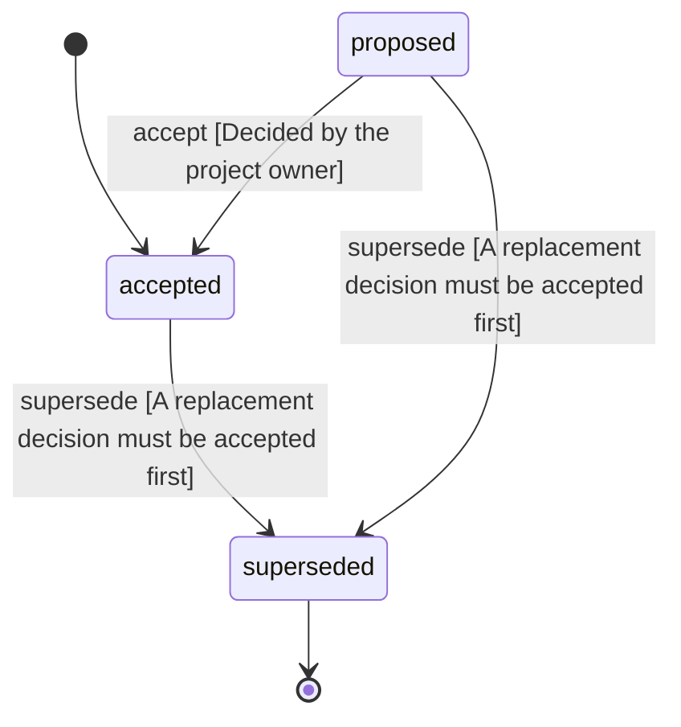

<!-- @generated by @newel/generator-wiki — do not edit -->
---
title: "DurabilityAndDestruction"
---

# DurabilityAndDestruction

`decision`

Every material has a durability, higher for rarer materials, that falls with weather, time and damage. Anyone may destroy a building, but only with effort that depends on its durability and the method, and very slowly while every owner is offline. A destroyer gets nothing from a building, but a destroyed chest spills its contents to anyone. A building stays its owner's until it is dismantled or destroyed. Dismantling returns materials by durability and building skill: all of them at full durability with a very high skill, half at full durability with no skill, less as durability falls. The owner repairs with part of the build materials. Any player may kill their own character to respawn, so no one can be trapped inside another's building.

> Make building meaningful with real risk, without letting a griefer take a house in one evening (DestructibleBuildings, TheWorldIsPersistent, Phase 203)

## Attributes

| Field | Type | Description |
| ----- | ---- | ----------- |
| status | `proposed`, `accepted`, `superseded` |  |
| decided | string | The day the owner decided it |

## Related

| Name | Kind | Target |
| ---- | ---- | ------ |
| durability | hasOne | [StructureDurability](structuredurability.md) |
| respawn | hasOne | [SelfRespawn](selfrespawn.md) |
| chests | hasOne | [ChestsAndDoors](chestsanddoors.md) |

## States

| State | Description |
| ----- | ----------- |
| `proposed` | Decision is under community discussion |
| `accepted` | Decision is ratified and in effect |
| `superseded` | Decision has been replaced by a newer decision |

## Actions

### accept

Ratify this decision

**Conditions:**
- Decided by the project owner

### supersede

Mark this decision as replaced by a newer one

**Conditions:**
- A replacement decision must be accepted first

