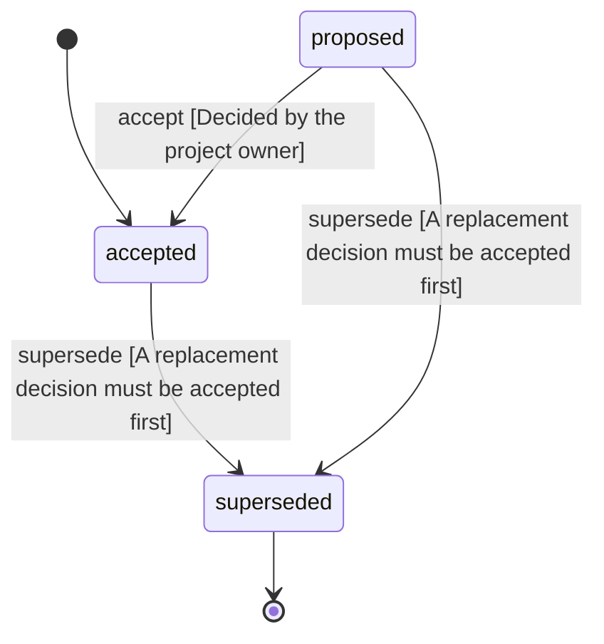

<!-- @generated by @newel/generator-wiki — do not edit -->
---
title: "EarthScaleHeights"
---

# EarthScaleHeights

`decision`

Peaks reach about 8,850 m (Everest is 8,849 m) and buildings up to 163 floors of 3 m. Every building follows the floor and shape limits of its weakest load-bearing material: wood 2 floors, stone 5, concrete 10, and higher classes up to 163. Unusual shapes (long overhangs, wide unsupported spans, slender towers) need rarer materials. Builds that exist when the rules land are never collapsed.

> Let players build as tall as Earth, as far as their materials allow (BelievableNotRealistic, Phase 203)

## Attributes

| Field | Type | Description |
| ----- | ---- | ----------- |
| status | `proposed`, `accepted`, `superseded` |  |
| decided | string | The day the owner decided it |

## Related

| Name | Kind | Target |
| ---- | ---- | ------ |
| world | hasOne | [WorldSystem](worldsystem.md) |
| structure | hasOne | [Structure](structure.md) |

## States

| State | Description |
| ----- | ----------- |
| `proposed` | Decision is under community discussion |
| `accepted` | Decision is ratified and in effect |
| `superseded` | Decision has been replaced by a newer decision |

## Actions

### accept

Ratify this decision

**Conditions:**
- Decided by the project owner

### supersede

Mark this decision as replaced by a newer one

**Conditions:**
- A replacement decision must be accepted first

