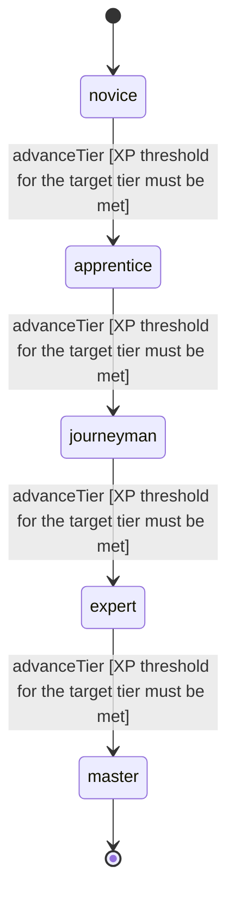

<!-- @generated by @newel/generator-wiki — do not edit -->
---
title: "Foraging"
---

# Foraging

`skill`

Gathering plants, herbs and fruit by hand. Every plant gathered grows it; each tier takes more from the same plant.

> Record that a player is a forager, apart from the alchemist who brews what is found

## Attributes

| Field | Type | Description |
| ----- | ---- | ----------- |
| tier | `novice`, `apprentice`, `journeyman`, `expert`, `master` |  |
| xpCurve | `linear`, `quadratic`, `exponential` | XP required per tier |
| maxLevel | integer | Maximum XP level within a tier before tier advance is required; the same as levelCap |
| category | `combat`, `crafting`, `magic`, `exploration`, `social`, `gathering` | Skill domain: gathering |
| levelCap | integer | Highest Foraging level (WorkSkills.curves) |
| xpToLevel | json | Cumulative XP needed to reach each level, index = level (WorkSkills.curves) |
| tierBonus | json | What each tier gives (WorkSkills.bonuses): a yield factor on plants gathered |

## States

| State | Description |
| ----- | ----------- |
| `novice` | Entry-level practitioner; basic techniques only |
| `apprentice` | Growing competence; intermediate techniques unlock |
| `journeyman` | Solid practitioner; advanced techniques and profession gates open |
| `expert` | Near-mastery; most advanced abilities available |
| `master` | Complete mastery; all abilities unlocked |

## Actions

### advanceTier

Reach the next tier from accumulated Foraging XP (WorkSkills.tiers)

**Conditions:**
- XP threshold for the target tier must be met

### forage

Grow Foraging from the work its rows in WorkSkills.gather name

**Conditions:**
- The host grants the XP per unit gathered from WorkSkills.gather, never from a client message
- Each tier applies its WorkSkills.bonuses.Foraging factor

