<!-- @generated by @newel/generator-wiki — do not edit -->
---
title: "Lockpick"
---

# Lockpick

`item`

A bent ferrite pin on a thornwood grip. Picks the lock of a chest or door; a failed pick can snap it.

> The lockpicking tool: a locked chest is never unbreakable (Phase 208)

## Attributes

| Field | Type | Description |
| ----- | ---- | ----------- |
| condition | `pristine`, `worn`, `damaged`, `broken` |  |
| weight | decimal | kg; affects carry capacity |
| rarity | `common`, `uncommon`, `rare`, `epic`, `legendary` |  |
| stackable | boolean | Whether multiple instances stack in inventory |
| shape | json | Item shape: archetype, material per named part, and uniform scale (Phase 151) |
| durability | integer | Remaining durability points before condition degrades |
| toolType | string | Tool class — "lockpick" picks locks (ChestsAndDoors.locks.toolType) |

## Related

| Name | Kind | Target |
| ---- | ---- | ------ |
| ferrite | hasOne | [Ferrite](ferrite.md) |
| thornwood | hasOne | [Thornwood](thornwood.md) |

## States

```mermaid
stateDiagram-v2
  [*] --> pristine
  pristine --> worn : degrade [A failed pick breaks the tool with ChestsAndDoors.locks.breakChance / difficulty]
  worn --> damaged : degrade [A failed pick breaks the tool with ChestsAndDoors.locks.breakChance / difficulty]
  damaged --> broken : degrade [A failed pick breaks the tool with ChestsAndDoors.locks.breakChance / difficulty]
  broken --> pristine : repair [Requires a forge; no additional materials consumed]
  damaged --> pristine : repair [Requires a forge; no additional materials consumed]
  worn --> pristine : repair [Requires a forge; no additional materials consumed]
```

| State | Description |
| ----- | ----------- |
| `pristine` | Freshly crafted or repaired; full stat effectiveness |
| `worn` | Showing use; minor stat penalties apply |
| `damaged` | Significantly degraded; notable stat penalties; repair strongly advised |
| `broken` | Unusable; must be repaired at a workshop before use |

## Actions

### degrade

A failed pick can break the lockpick

**Conditions:**
- A failed pick breaks the tool with ChestsAndDoors.locks.breakChance / difficulty

### repair

Re-file a worn lockpick at a forge

**Conditions:**
- Requires a forge; no additional materials consumed

