<!-- @generated by @newel/generator-wiki — do not edit -->
---
title: "Lockpicking"
---

# Lockpicking

`skill`

Opening a locked chest or door without breaking it. A higher level picks harder locks faster and breaks fewer tools; a lock's difficulty comes from its material and technology (ChestsAndDoors.locks).

> Make a locked chest a puzzle to work rather than an absolute wall

## Attributes

| Field | Type | Description |
| ----- | ---- | ----------- |
| tier | `novice`, `apprentice`, `journeyman`, `expert`, `master` |  |
| xpCurve | `linear`, `quadratic`, `exponential` | XP required per tier |
| maxLevel | integer | Maximum XP level within a tier before tier advance is required; the same as levelCap |
| category | `combat`, `crafting`, `magic`, `exploration`, `social`, `survival` | Skill domain: exploration |
| levelCap | integer | Highest Lockpicking level (WorkSkills.curves) |
| xpToLevel | json | Cumulative XP needed to reach each level, index = level (WorkSkills.curves) |

## States

```mermaid
stateDiagram-v2
  [*] --> novice
  novice --> apprentice : advanceTier [XP threshold for the target tier must be met; XP comes only from the work WorkSkills maps to Lockpicking]
  apprentice --> journeyman : advanceTier [XP threshold for the target tier must be met; XP comes only from the work WorkSkills maps to Lockpicking]
  journeyman --> expert : advanceTier [XP threshold for the target tier must be met; XP comes only from the work WorkSkills maps to Lockpicking]
  expert --> master : advanceTier [XP threshold for the target tier must be met; XP comes only from the work WorkSkills maps to Lockpicking]
  master --> [*]
```

| State | Description |
| ----- | ----------- |
| `novice` | Entry-level practitioner; basic techniques only |
| `apprentice` | Growing competence; intermediate techniques unlock |
| `journeyman` | Solid practitioner; advanced techniques and profession gates open |
| `expert` | Near-mastery; most advanced abilities available |
| `master` | Complete mastery; all abilities unlocked |

## Actions

### advanceTier

Progress to the next mastery tier through accumulated lockpicking XP

**Conditions:**
- XP threshold for the target tier must be met
- XP comes only from the work WorkSkills maps to Lockpicking

### pickLock

Open a locked chest or door once with a lockpick

**Conditions:**
- Takes longer for a harder lock (ChestsAndDoors.locks)
- A failed pick can break the tool, and the owner is told

