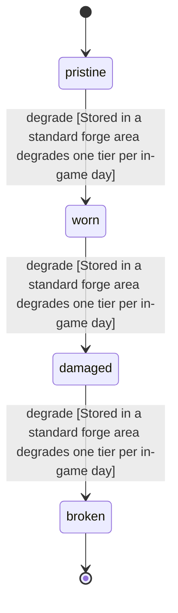

<!-- @generated by @newel/generator-wiki — do not edit -->
---
title: "RefinedVoiditeShard"
---

# RefinedVoiditeShard

`item`

Raw voidite stabilised in a forge into a crystalline shard. The input of void rune etching and the repair material for voidite blades.

> Discrete refined form of voidite; the product of the risky refining recipe

## Attributes

| Field | Type | Description |
| ----- | ---- | ----------- |
| condition | `pristine`, `worn`, `damaged`, `broken` |  |
| weight | decimal | kg per shard |
| rarity | `common`, `uncommon`, `rare`, `epic`, `legendary` |  |
| stackable | boolean | True; stacks up to 20 per slot |
| durability | integer | Crystal integrity |

## Related

| Name | Kind | Target |
| ---- | ---- | ------ |
| voidite | hasOne | [Voidite](voidite.md) |

## States

| State | Description |
| ----- | ----------- |
| `pristine` | Full potency or freshness; ready for use |
| `worn` | Reduced potency; still usable |
| `damaged` | Significantly degraded; use with caution |
| `broken` | Spoiled or fully depleted; cannot be used or repaired |

## Actions

### degrade

Shard integrity degrades outside void-lined storage

**Conditions:**
- Stored in a standard forge area: degrades one tier per in-game day

