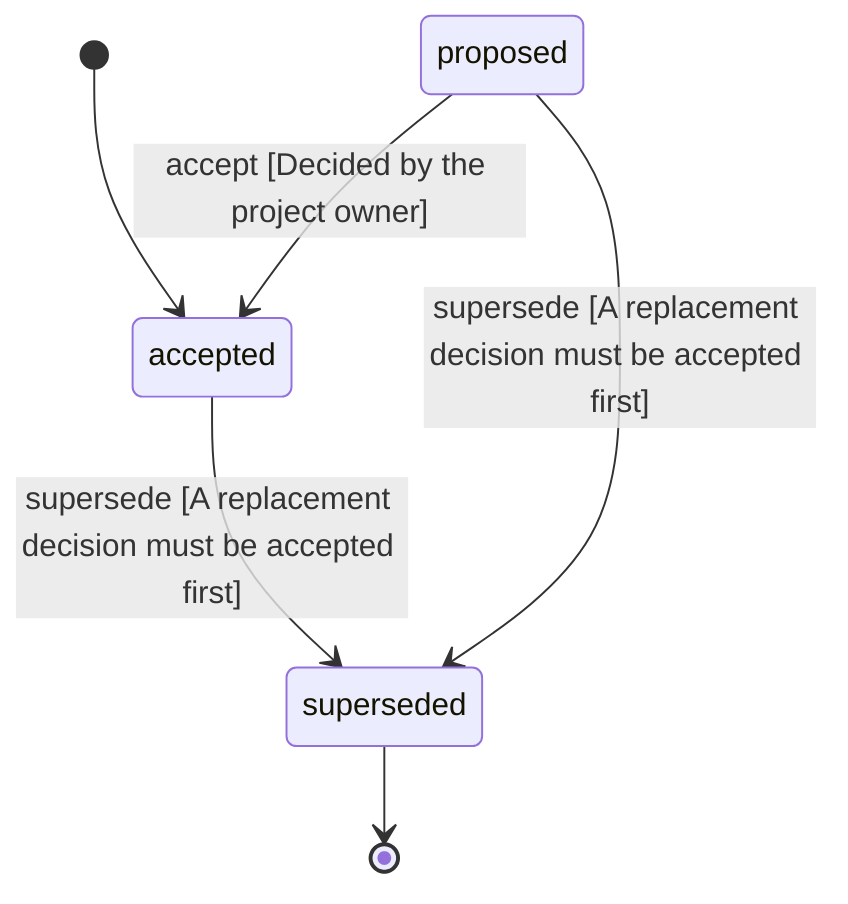

<!-- @generated by @newel/generator-wiki — do not edit -->
---
title: "ResearchSharedByWriting"
---

# ResearchSharedByWriting

`decision`

Research is per player and is shared only by writing: a Book teaches one researched technology and a Blueprint one structure or station recipe. Only a player who knows the content can write one, at a material cost, and reading never consumes it, so it can be read again and lent. Research never draws from a shared stockpile.

> Keep knowledge a personal achievement that players trade and teach (KnowledgeIsProgression, Phase 203)

## Attributes

| Field | Type | Description |
| ----- | ---- | ----------- |
| status | `proposed`, `accepted`, `superseded` |  |
| decided | string | The day the owner decided it |

## Related

| Name | Kind | Target |
| ---- | ---- | ------ |
| book | hasOne | [Book](book.md) |
| blueprint | hasOne | [Blueprint](blueprint.md) |

## States

| State | Description |
| ----- | ----------- |
| `proposed` | Decision is under community discussion |
| `accepted` | Decision is ratified and in effect |
| `superseded` | Decision has been replaced by a newer decision |

## Actions

### accept

Ratify this decision

**Conditions:**
- Decided by the project owner

### supersede

Mark this decision as replaced by a newer one

**Conditions:**
- A replacement decision must be accepted first

