<!-- @generated by @newel/generator-wiki — do not edit -->
---
title: "Settlement"
---

# Settlement

`world-system`

A player-founded village: a Hearth, members with roles and a shared Stockpile. It grows from founded to growing to town as members and days accumulate (growing also by completed projects), members build projects together, and it is abandoned when no member is active. Phase 203 replaced its claim with owned structures and clans: a settlement claims no land, and Phase 204 migrates each one to a Clan with the same name, members and roles (Clan.migration). Rule changes are made through GovernanceSystem proposals.

> Give players a shared place to build a civilization together (CivilizationIsPlayerMade)

## Attributes

| Field | Type | Description |
| ----- | ---- | ----------- |
| name | string | Display name chosen by the founder |
| founder | string | Player id of the founder; always a member with the founder role |
| members | json | Player id -> role (founder, elder, member, guest) |
| guild | string | Guild that holds this settlement, empty if none; a guild holds at most guildMaxSettlements |
| createdAt | datetime | Wall-clock time the hearth was placed |
| lastActiveAt | datetime | Wall-clock time any member was last active |
| rules | json | Settlement rule table: { hearthStation, hearthItem, guildMaxSettlements, tiers, roles, stockpile, abandonAfterDays } (validated at fabric load) |
| status | `founded`, `growing`, `town`, `abandoned` | Lifecycle tier of the settlement |

## Related

| Name | Kind | Target |
| ---- | ---- | ------ |
| hearth | hasOne | [Hearth](hearth.md) |
| stockpile | hasOne | [Stockpile](stockpile.md) |
| governance | hasOne | [GovernanceSystem](governancesystem.md) |
| recipe | hasOne | [RecipeHearth](recipehearth.md) |
| projects | hasOne | [SettlementProjects](settlementprojects.md) |
| specialties | hasOne | [SettlementSpecialties](settlementspecialties.md) |
| clan | hasOne | [Clan](clan.md) |
| decision | hasOne | [ClansAndOwnedStructures](clansandownedstructures.md) |

## States

```mermaid
stateDiagram-v2
  [*] --> founded
  founded --> growing : grow [minMembers of the next tier must be met, and either its minDays or (when it has one) its minProjects completed settlement projects; Stockpile capacity rises to the new tier's value and never shrinks]
  growing --> town : grow [minMembers of the next tier must be met, and either its minDays or (when it has one) its minProjects completed settlement projects; Stockpile capacity rises to the new tier's value and never shrinks]
  founded --> abandoned : abandon [The Stockpile contents are kept for members who return]
  growing --> abandoned : abandon [The Stockpile contents are kept for members who return]
  town --> abandoned : abandon [The Stockpile contents are kept for members who return]
  abandoned --> founded : reclaim [The settlement returns to founded and grows with the tiers again]
```

| State | Description |
| ----- | ----------- |
| `founded` | The hearth is placed and the stockpile is at its smallest |
| `growing` | Enough members and days, or enough members and completed projects: the stockpile has grown |
| `town` | The top tier: the largest stockpile |
| `abandoned` | No member active for abandonAfterDays |

## Actions

### found

Place a Hearth to found a settlement

**Conditions:**
- Consumes one Hearth item (RecipeHearth)
- The placer becomes the founder and the first member

### grow

Raise the tier when member count and age meet the next tier thresholds

**Conditions:**
- minMembers of the next tier must be met, and either its minDays or (when it has one) its minProjects completed settlement projects
- Stockpile capacity rises to the new tier's value and never shrinks

### abandon

Mark a settlement with no member activity for abandonAfterDays as abandoned

**Conditions:**
- The Stockpile contents are kept for members who return

### reclaim

A member returns to an abandoned settlement

**Conditions:**
- The settlement returns to founded and grows with the tiers again

### changeRules

Change a settlement rule through a governance proposal

**Conditions:**
- A rule change is a GovernanceSystem proposal; it applies only once ratified
- Roles and withdraw limits are changed this way, never by the founder alone

### migrate

Become a clan (Phase 204)

**Conditions:**
- The clan keeps the settlement's name, members and roles (Clan.migration)
- The hearth is removed and returned to the founder as a Hearth item
- The stockpile becomes a clan chest with the same contents

