<!-- @generated by @newel/generator-wiki — do not edit -->
---
title: "Settlement"
---

# Settlement

`world-system`

A player-founded place: a Hearth, a claimed circle of land, members with roles and a shared Stockpile. It grows from founded to growing to town as members and days accumulate, and is abandoned when no member is active; an abandoned claim decays until the land is free again. A claim never covers another settlement's land. Rule changes are made through GovernanceSystem proposals.

> Give players a shared place to build a civilization together (CivilizationIsPlayerMade)

## Attributes

| Field | Type | Description |
| ----- | ---- | ----------- |
| name | string | Display name chosen by the founder |
| founder | string | Player id of the founder; always a member with the founder role |
| members | json | Player id -> role (founder, elder, member, guest) |
| guild | string | Guild that holds this settlement, empty if none; a guild holds at most guildMaxSettlements |
| createdAt | datetime | Wall-clock time the hearth was placed |
| lastActiveAt | datetime | Wall-clock time any member was last active inside the claim |
| rules | json | Settlement rule table: { hearthStation, hearthItem, guildMaxSettlements, tiers, roles, stockpile, abandonAfterDays, decayRadiusPerDay, minSeparation } (validated at fabric load) |
| status | `founded`, `growing`, `town`, `abandoned` | Lifecycle tier of the settlement |

## Related

| Name | Kind | Target |
| ---- | ---- | ------ |
| hearth | hasOne | [Hearth](hearth.md) |
| stockpile | hasOne | [Stockpile](stockpile.md) |
| governance | hasOne | [GovernanceSystem](governancesystem.md) |
| recipe | hasOne | [RecipeHearth](recipehearth.md) |

## States

```mermaid
stateDiagram-v2
  [*] --> founded
  founded --> growing : grow [Both minMembers and minDays of the next tier must be met; The claim radius and Stockpile capacity rise to the new tier's values and never shrink]
  growing --> town : grow [Both minMembers and minDays of the next tier must be met; The claim radius and Stockpile capacity rise to the new tier's values and never shrink]
  founded --> abandoned : abandon [The claim shrinks by decayRadiusPerDay each day until its land is free; The Stockpile contents are kept for members who return]
  growing --> abandoned : abandon [The claim shrinks by decayRadiusPerDay each day until its land is free; The Stockpile contents are kept for members who return]
  town --> abandoned : abandon [The claim shrinks by decayRadiusPerDay each day until its land is free; The Stockpile contents are kept for members who return]
  abandoned --> founded : reclaim [The settlement returns to founded and the claim regrows with the tiers]
```

| State | Description |
| ----- | ----------- |
| `founded` | The hearth is placed and the claim is at its smallest radius |
| `growing` | Enough members and days: the claim and stockpile have grown |
| `town` | The top tier: the largest claim and stockpile |
| `abandoned` | No member active for abandonAfterDays: the claim decays until the land is free |

## Actions

### found

Place a Hearth on free land to found a settlement

**Conditions:**
- Consumes one Hearth item (RecipeHearth)
- The claim must not overlap another settlement's claim: hearths are at least minSeparation apart
- The placer becomes the founder and the first member

### grow

Raise the tier when member count and age meet the next tier thresholds

**Conditions:**
- Both minMembers and minDays of the next tier must be met
- The claim radius and Stockpile capacity rise to the new tier's values and never shrink

### abandon

Mark a settlement with no member activity for abandonAfterDays as abandoned

**Conditions:**
- The claim shrinks by decayRadiusPerDay each day until its land is free
- The Stockpile contents are kept for members who return

### reclaim

A member returns to an abandoned settlement whose claim has not fully decayed

**Conditions:**
- The settlement returns to founded and the claim regrows with the tiers

### changeRules

Change a settlement rule through a governance proposal

**Conditions:**
- A rule change is a GovernanceSystem proposal; it applies only once ratified
- Claim radius, roles and withdraw limits are changed this way, never by the founder alone

### build

Build or break inside the claim

**Conditions:**
- Only roles with build permission may build inside the claim
- Outsiders may not build or take inside a claim

