<!-- @generated by @newel/generator-wiki — do not edit -->
---
title: "SettlementClaimAndDecay"
---

# SettlementClaimAndDecay

`decision`

Settlements claim land around a Hearth, with a radius that only grows with tier. A claim never covers another settlement's land (hearths are at least minSeparation apart), and an abandoned settlement's claim decays until the land is free. Claim and role rules change only through GovernanceSystem proposals.

> Let players hold land together without letting an inactive claim lock the world forever (TheWorldIsPersistent, CivilizationIsPlayerMade)

## Attributes

| Field | Type | Description |
| ----- | ---- | ----------- |
| status | `proposed`, `accepted`, `superseded` |  |

## Related

| Name | Kind | Target |
| ---- | ---- | ------ |
| settlement | hasOne | [Settlement](settlement.md) |

## States

```mermaid
stateDiagram-v2
  [*] --> proposed
  proposed --> accepted : accept [Community vote must reach quorum; Claim radius, decay and separation values live in Settlement rules]
  proposed --> superseded : supersede [A replacement decision must be accepted first]
  accepted --> superseded : supersede [A replacement decision must be accepted first]
  superseded --> [*]
```

| State | Description |
| ----- | ----------- |
| `proposed` | Decision is under community discussion |
| `accepted` | Decision is ratified and in effect |
| `superseded` | Decision has been replaced by a newer decision |

## Actions

### accept

Ratify the claim and decay rules after community review

**Conditions:**
- Community vote must reach quorum
- Claim radius, decay and separation values live in Settlement rules

### supersede

Mark this decision as replaced by a newer one

**Conditions:**
- A replacement decision must be accepted first

