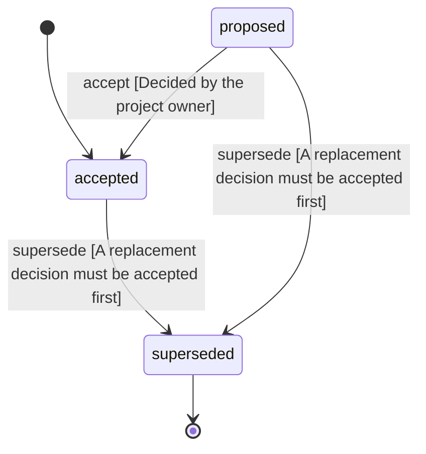

<!-- @generated by @newel/generator-wiki — do not edit -->
---
title: "SkillsGrowFromWork"
---

# SkillsGrowFromWork

`decision`

Crafting, gathering, building, dismantling and repairing grow the worker's own skill for that kind of work (sewing makes you a better sewer). Nothing a member does is progress for a clan: clan projects have no labour and are complete once their materials are in. Clan tiers come from the buildings a clan owns and their material rarity, and give nothing yet. Raids are not wanted now (deferred) and upkeep is removed. Clan skills for top contributors and elder-only buildings come later.

> Make a specialty the result of how someone plays, and a clan the sum of its members (EverythingHasTradeoffs, Phase 203)

## Attributes

| Field | Type | Description |
| ----- | ---- | ----------- |
| status | `proposed`, `accepted`, `superseded` |  |
| decided | string | The day the owner decided it |

## Related

| Name | Kind | Target |
| ---- | ---- | ------ |
| work | hasOne | [WorkSkills](workskills.md) |
| tiers | hasOne | [ClanTiers](clantiers.md) |
| replaces | hasOne | [SettlementRaidsAndUpkeep](settlementraidsandupkeep.md) |

## States

| State | Description |
| ----- | ----------- |
| `proposed` | Decision is under community discussion |
| `accepted` | Decision is ratified and in effect |
| `superseded` | Decision has been replaced by a newer decision |

## Actions

### accept

Ratify this decision

**Conditions:**
- Decided by the project owner

### supersede

Mark this decision as replaced by a newer one

**Conditions:**
- A replacement decision must be accepted first

