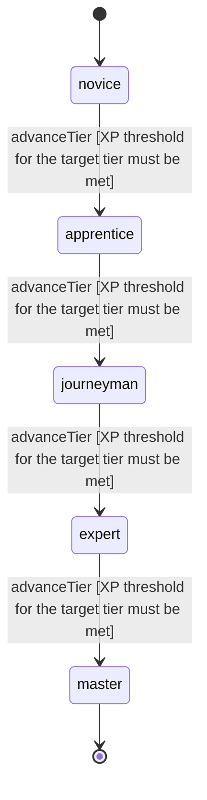

<!-- @generated by @newel/generator-wiki — do not edit -->
---
title: "Skinning"
---

# Skinning

`skill`

Working a creature body with a knife or bone tool. A higher level takes more from the same body (quantity runs from the table's minimum at level 0 to its maximum at the cap), more reliably, and of better quality. It also lets a harvester carry heavier bodies.

> Make a kill a body to work rather than a pile of finished drops, and reward practice with the knife

## Attributes

| Field | Type | Description |
| ----- | ---- | ----------- |
| tier | `novice`, `apprentice`, `journeyman`, `expert`, `master` |  |
| xpCurve | `linear`, `quadratic`, `exponential` | XP required per tier |
| maxLevel | integer | Maximum XP level within a tier before tier advance is required; the same as levelCap |
| category | `combat`, `crafting`, `magic`, `exploration`, `social`, `survival` | Skill domain: survival |
| levelCap | integer | Highest Skinning level; the tables below have one entry per level 0..levelCap |
| xpToLevel | json | Cumulative XP needed to reach each level, index = level |
| yieldCurve | json | Fraction 0..1 of the minQty..maxQty range a harvest reaches, index = effective level |
| chanceCurve | json | Chance added to each entry (total capped at 1.0), index = effective level |
| qualityCurve | json | Quality grade (poor, common, fine, prime) of raw creature materials, index = effective level |

## States

| State | Description |
| ----- | ----------- |
| `novice` | Entry-level practitioner; basic techniques only |
| `apprentice` | Growing competence; intermediate techniques unlock |
| `journeyman` | Solid practitioner; advanced techniques and profession gates open |
| `expert` | Near-mastery; most advanced abilities available |
| `master` | Complete mastery; all abilities unlocked |

## Actions

### advanceTier

Progress to the next mastery tier through accumulated skinning XP

**Conditions:**
- XP threshold for the target tier must be met

### harvest

Work a creature body with the right tool

**Conditions:**
- Effective level is floor(level * tool efficiency); it indexes yieldCurve, chanceCurve and qualityCurve
- Quality is a property of the item instance, not a separate item id
- A finished harvest grants the Skinning XP of the WorkSkills carcass row

