<!-- @generated by @newel/generator-wiki — do not edit -->
---
title: "StoneHammer"
---

# StoneHammer

`item`

A heavy round stone bound to a short branch. Held to build walls, floors and roofs; benches need none.

> The building tool: a shelter needs a hammer in hand, a bench does not (Phase 260)

## Attributes

| Field | Type | Description |
| ----- | ---- | ----------- |
| condition | `pristine`, `worn`, `damaged`, `broken` |  |
| weight | decimal | kg; affects carry capacity |
| rarity | `common`, `uncommon`, `rare`, `epic`, `legendary` |  |
| stackable | boolean | Whether multiple instances stack in inventory |
| shape | json | Item shape: archetype, material per named part, and uniform scale (Phase 151) |
| durability | integer | Remaining durability points before condition degrades |
| equipmentCategory | string | Equipment category (Phase 295): knife, sword, axe, hammer, pick, shovel… |
| traits | json | Traits and strengths (Phase 295): { <Trait>: { strength, grade? } }; the working part's material may raise them |
| tier | string | Gear tier (Phase 229, a skill tier): the highest ability or recipe tier this item allows (GearTiers) |
| repair | json | Structured repair spec: required station, materials consumed on repair, and skill guards (skill key + minimum tier). |
| works | json | Derived from the work table (Phase 295): { <work>: speed } for every work this item can do |
| combatDamage | json | Derived (Phase 295): combat damage per damage type, the category multiplier times its traits' shares |

## Related

| Name | Kind | Target |
| ---- | ---- | ------ |
| ashite | hasOne | [Ashite](ashite.md) |
| thornwood | hasOne | [Thornwood](thornwood.md) |

## States

```mermaid
stateDiagram-v2
  [*] --> pristine
  pristine --> worn : degrade [Each use consumes one durability point]
  worn --> damaged : degrade [Each use consumes one durability point]
  damaged --> broken : degrade [Each use consumes one durability point]
  broken --> pristine : repair [Needs no station; Repair costs one loose stone per condition tier restored]
  damaged --> pristine : repair [Needs no station; Repair costs one loose stone per condition tier restored]
  worn --> pristine : repair [Needs no station; Repair costs one loose stone per condition tier restored]
```

| State | Description |
| ----- | ----------- |
| `pristine` | Freshly crafted or repaired; full stat effectiveness |
| `worn` | Showing use; minor stat penalties apply |
| `damaged` | Significantly degraded; notable stat penalties; repair strongly advised |
| `broken` | Unusable; must be repaired at a workshop before use |

## Actions

### degrade

Reduce durability with each use; a stone head chips quickly

**Conditions:**
- Each use consumes one durability point

### repair

Knap a fresh edge onto the head with a loose stone, anywhere

**Conditions:**
- Needs no station
- Repair costs one loose stone per condition tier restored

