<!-- @generated by @newel/generator-wiki — do not edit -->
---
title: "StoneKnife"
---

# StoneKnife

`item`

A sharp flake of stone in a branch grip. Skins and butchers, poorly.

> A first knife for harvesting a kill before the forge (Phase 260)

## Attributes

| Field | Type | Description |
| ----- | ---- | ----------- |
| condition | `pristine`, `worn`, `damaged`, `broken` |  |
| weight | decimal | kg; affects carry capacity |
| rarity | `common`, `uncommon`, `rare`, `epic`, `legendary` |  |
| stackable | boolean | Whether multiple instances stack in inventory |
| shape | json | Item shape: archetype, material per named part, and uniform scale (Phase 151) |
| durability | integer | Remaining durability points before condition degrades |
| harvestTool | string | Harvest tool category this item provides (Phase 160): knife or bonetool |
| efficiency | decimal | How well it works that category, in (0, 1]; below 1.0 is a poor substitute |
| repair | json | Structured repair spec: required station, materials consumed on repair, and skill guards (skill key + minimum tier). |

## Related

| Name | Kind | Target |
| ---- | ---- | ------ |
| ashite | hasOne | [Ashite](ashite.md) |
| thornwood | hasOne | [Thornwood](thornwood.md) |

## States

```mermaid
stateDiagram-v2
  [*] --> pristine
  pristine --> worn : degrade [Each use consumes one durability point]
  worn --> damaged : degrade [Each use consumes one durability point]
  damaged --> broken : degrade [Each use consumes one durability point]
  broken --> pristine : repair [Needs no station; Repair costs one loose stone per condition tier restored]
  damaged --> pristine : repair [Needs no station; Repair costs one loose stone per condition tier restored]
  worn --> pristine : repair [Needs no station; Repair costs one loose stone per condition tier restored]
```

| State | Description |
| ----- | ----------- |
| `pristine` | Freshly crafted or repaired; full stat effectiveness |
| `worn` | Showing use; minor stat penalties apply |
| `damaged` | Significantly degraded; notable stat penalties; repair strongly advised |
| `broken` | Unusable; must be repaired at a workshop before use |

## Actions

### degrade

Reduce durability with each use; a stone head chips quickly

**Conditions:**
- Each use consumes one durability point

### repair

Knap a fresh edge onto the head with a loose stone, anywhere

**Conditions:**
- Needs no station
- Repair costs one loose stone per condition tier restored

