<!-- @generated by @newel/generator-wiki — do not edit -->
---
title: "TechBasicSmithing"
---

# TechBasicSmithing

`technology`

Foundational metalworking knowledge. Unlocks the forge structure, ferrite smelting, and all Smithing: Novice recipes. Every civilization needs this first.

> Root node of the smithing tree; accessible to all players from the opening hours

## Attributes

| Field | Type | Description |
| ----- | ---- | ----------- |
| status | `locked`, `researching`, `unlocked` |  |
| researchCost | integer | Research points spent to begin research (Phase 124); earned by the ResearchPointRule table |
| tier | integer | Technology tree tier (1 = root) |
| tech | json | Structured technology data: recipe unlocks, prerequisite technologies, research duration (seconds), and material cost consumed to begin research. |

## Related

| Name | Kind | Target |
| ---- | ---- | ------ |
| unlocksRecipeFerriteIngot | hasOne | [RecipeFerriteIngot](recipeferriteingot.md) |
| unlocksRecipeFerriteShortSword | hasOne | [RecipeFerriteShortSword](recipeferriteshortsword.md) |
| unlocksRecipeFerritePick | hasOne | [RecipeFerritePick](recipeferritepick.md) |
| unlocksRecipeSkinningKnife | hasOne | [RecipeSkinningKnife](recipeskinningknife.md) |
| unlocksRecipeBoneSaw | hasOne | [RecipeBoneSaw](recipebonesaw.md) |
| unlocksRecipeLockpick | hasOne | [RecipeLockpick](recipelockpick.md) |

## States

```mermaid
stateDiagram-v2
  [*] --> locked
  locked --> researching : beginResearch [No prerequisites required; Research is per player and can be done anywhere; it is shared only by writing a Book (Phase 203)]
  researching --> unlocked : completeResearch [Research cost fully paid; all related recipes become craftable]
  unlocked --> [*]
```

| State | Description |
| ----- | ----------- |
| `locked` | Prerequisites not yet met; technology is not visible in the research interface |
| `researching` | Player or guild has committed resources; research progresses over time |
| `unlocked` | Research complete; all associated recipes and abilities are available |

## Actions

### beginResearch

Commit resources to researching basic smithing

**Conditions:**
- No prerequisites required
- Research is per player and can be done anywhere; it is shared only by writing a Book (Phase 203)

### completeResearch

Finish research and unlock all basic smithing recipes

**Conditions:**
- Research cost fully paid; all related recipes become craftable

