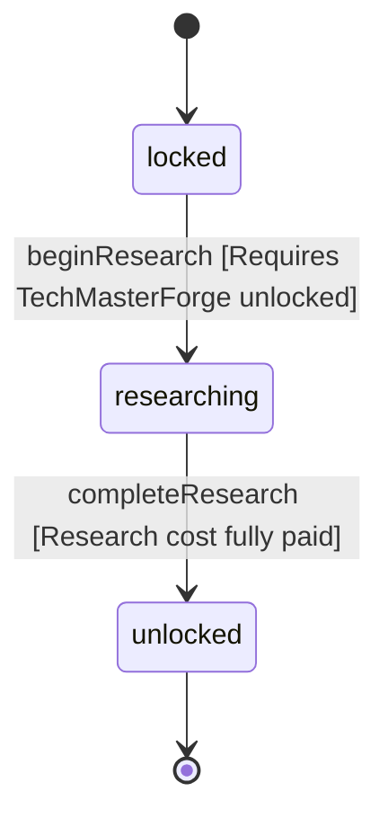

<!-- @generated by @newel/generator-wiki — do not edit -->
---
title: "TechConcrete"
---

# TechConcrete

`technology`

Grinding ashite to cement and casting it with soil. Unlocks concrete, which carries ten floors.

> The first material past stone (Phase 212)

## Attributes

| Field | Type | Description |
| ----- | ---- | ----------- |
| status | `locked`, `researching`, `unlocked` |  |
| researchCost | integer | Research points spent to begin research (Phase 124); earned by the ResearchPointRule table |
| tier | integer | Technology tree tier |
| tech | json | Structured technology data: recipe unlocks, prerequisite technologies, research duration (seconds), and material cost consumed to begin research. |

## Related

| Name | Kind | Target |
| ---- | ---- | ------ |
| requiresTechMasterForge | hasOne | [TechMasterForge](techmasterforge.md) |
| unlocksRecipeCement | hasOne | [RecipeCement](recipecement.md) |
| unlocksRecipeConcrete | hasOne | [RecipeConcrete](recipeconcrete.md) |

## States

| State | Description |
| ----- | ----------- |
| `locked` | Prerequisites not yet met; technology is not visible in the research interface |
| `researching` | Player or guild has committed resources; research progresses over time |
| `unlocked` | Research complete; all associated recipes and abilities are available |

## Actions

### beginResearch

Commit resources to concrete research

**Conditions:**
- Requires TechMasterForge: unlocked

### completeResearch

Finish research; its recipes become craftable

**Conditions:**
- Research cost fully paid

