<!-- @generated by @newel/generator-wiki — do not edit -->
---
title: "TechLeyframe"
---

# TechLeyframe

`technology`

Binding a steel lattice with aethermite at an arcane forge. Unlocks leyframe, the only material that carries 163 floors.

> The top structural class, gated by the ley lines (Phase 212)

## Attributes

| Field | Type | Description |
| ----- | ---- | ----------- |
| status | `locked`, `researching`, `unlocked` |  |
| researchCost | integer | Research points spent to begin research (Phase 124); earned by the ResearchPointRule table |
| tier | integer | Technology tree tier |
| tech | json | Structured technology data: recipe unlocks, prerequisite technologies, research duration (seconds), and material cost consumed to begin research. |

## Related

| Name | Kind | Target |
| ---- | ---- | ------ |
| requiresTechSteel | hasOne | [TechSteel](techsteel.md) |
| requiresTechArcaneForging | hasOne | [TechArcaneForging](techarcaneforging.md) |
| unlocksRecipeLeyframe | hasOne | [RecipeLeyframe](recipeleyframe.md) |

## States

```mermaid
stateDiagram-v2
  [*] --> locked
  locked --> researching : beginResearch [Requires TechSteel unlocked; Requires TechArcaneForging unlocked]
  researching --> unlocked : completeResearch [Research cost fully paid]
  unlocked --> [*]
```

| State | Description |
| ----- | ----------- |
| `locked` | Prerequisites not yet met; technology is not visible in the research interface |
| `researching` | Player or guild has committed resources; research progresses over time |
| `unlocked` | Research complete; all associated recipes and abilities are available |

## Actions

### beginResearch

Commit resources to leyframe research

**Conditions:**
- Requires TechSteel: unlocked
- Requires TechArcaneForging: unlocked

### completeResearch

Finish research; its recipes become craftable

**Conditions:**
- Research cost fully paid

