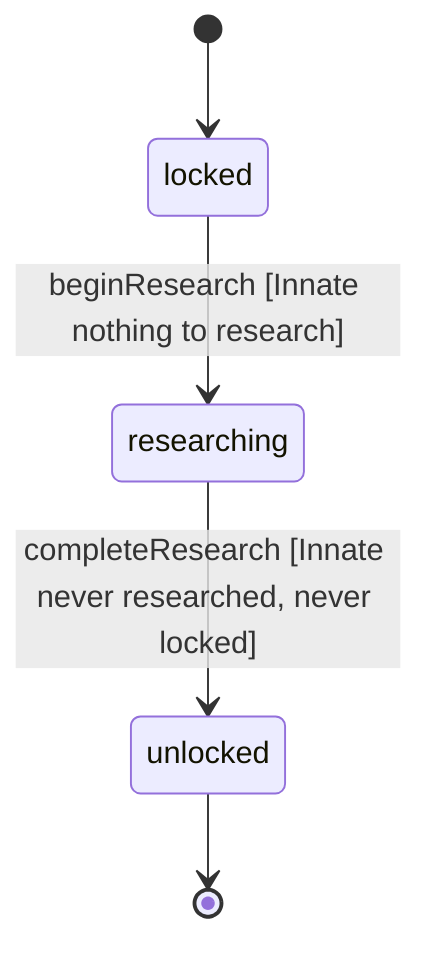

<!-- @generated by @newel/generator-wiki — do not edit -->
---
title: "TechStoneTools"
---

# TechStoneTools

`technology`

Lashing a stone to a branch. Every person knows it from the start: the stone axe, pick, shovel and knife need no station and no research.

> Root of everything: the first tools a newcomer makes with bare hands (Phase 260)

## Attributes

| Field | Type | Description |
| ----- | ---- | ----------- |
| status | `locked`, `researching`, `unlocked` |  |
| researchCost | integer | Research points spent to begin research (Phase 124); earned by the ResearchPointRule table |
| tier | integer | Technology tree tier (1 = root) |
| tech | json | Structured technology data: recipe unlocks, prerequisite technologies, research duration (seconds), and material cost consumed to begin research. |

## Related

| Name | Kind | Target |
| ---- | ---- | ------ |
| unlocksRecipeStoneAxe | hasOne | [RecipeStoneAxe](recipestoneaxe.md) |
| unlocksRecipeStonePick | hasOne | [RecipeStonePick](recipestonepick.md) |
| unlocksRecipeStoneShovel | hasOne | [RecipeStoneShovel](recipestoneshovel.md) |
| unlocksRecipeStoneKnife | hasOne | [RecipeStoneKnife](recipestoneknife.md) |

## States

| State | Description |
| ----- | ----------- |
| `locked` | Prerequisites not yet met; technology is not visible in the research interface |
| `researching` | Player or guild has committed resources; research progresses over time |
| `unlocked` | Research complete; all associated recipes and abilities are available |

## Actions

### beginResearch

Never begun: an innate technology is unlocked from the start

**Conditions:**
- Innate: nothing to research

### completeResearch

Known from birth: every character starts with it unlocked

**Conditions:**
- Innate: never researched, never locked

