<!-- @generated by @newel/generator-wiki — do not edit -->
---
title: "WaystonesAmendNoTeleportation"
---

# WaystonesAmendNoTeleportation

`decision`

Amends NoTeleportation: waystones are the one sanctioned fast travel. A player must build and stock a waystone network, travel only between stones they are attuned to, and pay an item cost scaled by distance, so travel remains infrastructure and a cost, never free or arbitrary teleportation.

> Keep a planet that takes about 90 days to walk around navigable without making geography meaningless

## Attributes

| Field | Type | Description |
| ----- | ---- | ----------- |
| status | `proposed`, `accepted`, `superseded` |  |

## States

```mermaid
stateDiagram-v2
  [*] --> proposed
  proposed --> accepted : accept [Community vote must reach quorum; Stones consume the Waystone item to place and an item cost to travel (WaystoneTravel)]
  proposed --> superseded : supersede [A replacement decision must be accepted first]
  accepted --> superseded : supersede [A replacement decision must be accepted first]
  superseded --> [*]
```

| State | Description |
| ----- | ----------- |
| `proposed` | Decision is under community discussion |
| `accepted` | Decision is ratified and in effect |
| `superseded` | Decision has been replaced by a newer decision |

## Actions

### accept

Ratify this amendment after community review

**Conditions:**
- Community vote must reach quorum
- Stones consume the Waystone item to place and an item cost to travel (WaystoneTravel)

### supersede

Mark this decision as replaced by a newer one

**Conditions:**
- A replacement decision must be accepted first

